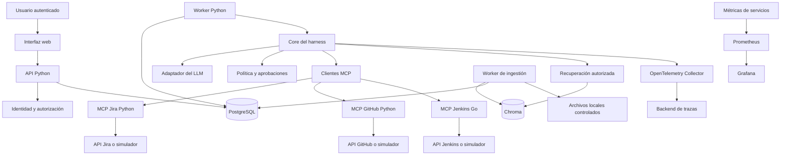

# Etapa 2 — Arquitectura del harness DevOps

> **Estado actualizado:** el recorrido de lectura usa modelo y backends DevOps simulados. PostgreSQL/API/workers, Jira MCP Streamable HTTP con identidad de servicio/TLS, rotación y observabilidad funcionan en local. M4a–M4h incluyen propuestas/aprobaciones, ledger, despacho MCP, frontend, cierre revisado, worker de escrituras, trazas/métricas y ocho evaluaciones deterministas. Siguen pendientes identidad de usuarios y aislamiento operativo completos, RAG M5 y proveedores/LLM reales de M7. Ver [la matriz de cierre](docs/status.md) y [la guía](docs/guide.md) para evidencia y límites.

**Estado:** arquitectura objetivo y camino incremental; el avance implementado hasta M4h se distingue en la nota anterior. Leer primero [alcance](01-alcance-y-escenarios.md); complementar con [amenazas](03-modelo-de-amenazas.md) y [contratos](04-contratos-y-estados.md).

## 1. Decisión principal

El core del harness pertenece a la aplicación y controla el ciclo: construir contexto autorizado, pedir una decisión al modelo, validar, autorizar, ejecutar, registrar y continuar o detenerse. El modelo propone acciones; nunca concede permisos.

En el laboratorio anterior usamos Agents SDK. Para comprender el core, esta etapa comenzará con un `LLMPort` y un adaptador de function calling mediante el SDK de OpenAI, sin delegar el loop completo a un framework. No implementamos un cliente HTTP de modelos desde cero: usamos el SDK para transporte y normalización. El flujo aplicación→modelo→herramienta→modelo está descrito en la [documentación oficial de function calling](https://developers.openai.com/api/docs/guides/function-calling).

Solo habrá un propietario del loop. Agents SDK o LangGraph podrán incorporarse como una implementación alternativa posterior, conservando pruebas, políticas y contratos de operación. El core no importará clases de Gradio, FastAPI, Chroma ni del SDK del proveedor.

## 2. Arquitectura objetivo

El diagrama muestra responsabilidades; no obliga a crear un microservicio por caja. API y worker pueden compartir paquete Python; recuperación e ingestión comienzan como módulos. La separación Python↔Go sí será un contrato real de proceso y protocolo.

## 3. Componentes y por qué existen

| Componente | Responsabilidad | Lo que no decide |
| --- | --- | --- |
| API FastAPI en Python | Autenticar, validar solicitudes, iniciar runs, aprobar, cancelar y consultar estado. | No ejecuta trabajos largos dentro de la petición HTTP. |
| Core Python | Loop, estados, límites, herramientas y resultado parcial/final. | No acepta identidades ni permisos derivados del prompt. |
| Worker | Reclamar trabajo persistido, ejecutar pasos y renovar lease. | No presume que una caída anuló una acción externa. |
| MCP Jira/GitHub Python | Traducir contratos a APIs, validar recursos y limitar respuestas. | No ofrece HTTP arbitrario, shell o credenciales al modelo. |
| MCP Jenkins Go | Consultar builds; posteriormente solicitar un job autorizado. | No acepta scripts o URLs elegidas por el LLM. |
| PostgreSQL | Fuente de verdad de runs, operaciones, aprobaciones, jobs y auditoría. | No hace una transacción atómica con Jenkins. |
| Chroma | Buscar embeddings de una versión autorizada del corpus. | No es fuente de verdad de identidades ni permisos. |
| OpenTelemetry/Prometheus/Grafana | Trazas, métricas y exploración operativa. | No sustituyen el ledger de operaciones ni su auditoría durable. |

Elegimos Go para una integración útil, Jenkins, y Python para el harness y contexto. Así se practican `context.Context`, deadlines y errores tipados en Go junto a `asyncio`, cancelación y validación en Python. El servidor de Go usará el [SDK oficial de MCP](https://github.com/modelcontextprotocol/go-sdk); fijaremos versiones compatibles al implementar, en lugar de inventar números en el diseño.

## 4. Cómo crece sin volverse inmanejable

M0/M1 usan una entrada de consola, LLM falso y SQLite local; no levantamos PostgreSQL para aprender una transición. SQLite sirve a una única instancia del ejercicio, no como promesa de coordinación distribuida.

M2 introduce MCP por stdio para aprender cliente, sesión, descubrimiento y ejecución. M3 incorpora PostgreSQL y separa progresivamente los MCP por Streamable HTTP. El primer servicio independiente es Jira: permanece vivo entre consultas y autentica al worker con tokens Ed25519 de un emisor local separado y cifra con TLS. El cliente abre una conexión por invocación dentro del timeout del core; un pool duradero queda para un incremento posterior. GitHub/Jenkins conservan stdio.

M3a y M3b ya implementan API local sobre core/SQLite y frontend de escenarios/runs/evidencia/recuperación. M3c ya incorpora PostgreSQL, productor API y worker independiente; Compose opera los servicios y Jira ya tiene identidad de servicio local verificable. El emisor educativo implementa un flujo client_credentials acotado y publica JWKS; Ya hay mantenimiento coordinado y en vivo para certificados/firma, generaciones atómicas, anuncio previo y solapamiento acotado, más un planificador local persistido. OpenTelemetry/Jaeger ya muestran intentos distribuidos con links durables en jobs y metadatos acotados; tracing es best effort y no gobierna recuperación. Prometheus/Grafana agregan métricas con etiquetas acotadas y un dashboard provisionado; los estados actuales se leen de PostgreSQL y los contadores de intentos siguen siendo observación de proceso. OIDC, alta disponibilidad, alertas y credenciales administradas de producción siguen pendientes. El frontend consulta el backend y no duplica políticas ni adjudica roles desde el navegador. Las propuestas y su UI llegarán en M4. La tecnología del frontend completo sigue abierta; la primera pantalla no equivale a operación distribuida.

## 5. Loop y composición del contexto

1. Cargar el run y su identidad validada; fijar versión de configuración y política.
2. Obtener capacidades permitidas para actor, workspace y recursos.
3. Construir contexto con instrucciones de aplicación, solicitud y evidencia autorizada.
4. Consultar el adaptador LLM con schemas estrictos y presupuesto restante.
5. Validar cada propuesta: herramienta conocida, argumentos, tamaño y recursos permitidos.
6. Si es lectura, ejecutar con deadline y registrar evidencia. Si es escritura, crear una propuesta y persistir la pausa.
7. Añadir resultados como datos de herramienta con procedencia; nunca convertirlos en instrucciones de sistema.
8. Terminar, producir resultado parcial o continuar dentro del presupuesto.

La política determina qué lecturas independientes pueden hacerse concurrentemente. Las escrituras se serializan por recurso al principio. Que el modelo emita varias llamadas no autoriza ejecutarlas en paralelo automáticamente.

El contexto guarda procedencia, revisión y fecha de observación. Si un diff es demasiado grande, se trunca de forma explícita o se rechaza; el informe indica qué evidencia falta. Un resumen automático puede perder información y no reemplaza un control de revisión de código.

## 6. Persistencia y trabajos

En M3 una transacción crea el run y su trabajo pendiente. El worker reclama un job con lease, versión y actualización condicional. No añadimos Redis y una cola externa al mismo tiempo: empezamos con la tabla de trabajos de PostgreSQL y medimos su límite.

El sistema persiste pasos significativos y referencias antes de un efecto. Las respuestas necesarias para reanudar se guardan con una política de acceso y retención; excluirlas de logs no basta para protegerlas. No se guardan secretos del proveedor ni cadenas de razonamiento privadas.

Los workers verifican propiedad y fencing token antes de cambiar estado. Eso protege escrituras locales de un worker obsoleto, pero no detiene por sí solo una solicitud remota ya enviada. El contrato remoto de idempotencia o reconciliación sigue siendo necesario.

## 7. Acciones y adaptadores externos

Una propuesta contiene herramienta, recurso, argumentos normalizados, revisión esperada, actor, workspace y vencimiento. La aprobación se vincula a su hash; el worker revalida política, revisión y aprobación justo antes de ejecutar.

No asumimos que Jira o Jenkins deduplican por un UUID que les enviamos. El simulador enseñará ese caso y también el caso sin garantía. Para un Jenkins real, el conector documentará si existe una correlación consultable fiable; ante incertidumbre sin prueba suficiente la operación queda UNKNOWN y requiere resolución. No ofreceremos una garantía de «exactamente una vez» por tener una tabla local.

Las credenciales de integración residen en el servicio MCP correspondiente. El token dirigido al harness no se reenvía como credencial de Jenkins/GitHub/Jira. Cada servidor valida su audiencia y aplica límites propios; es coherente con las [recomendaciones de seguridad MCP](https://modelcontextprotocol.io/docs/tutorials/security/security_best_practices).

## 8. Conocimiento e ingestión

El pipeline de conocimiento es distinto del loop del agente: validar archivo→extraer→dividir→embeddings→indexar versión candidata→validar→activar. Tiene jobs, límites, progreso y errores propios. El usuario puede subir, retirar y solicitar reindexación desde la API; la interfaz solo representa ese estado.

PostgreSQL conserva inventario, ACL, versión documental y puntero de índice activo. Los archivos se almacenan bajo IDs internos, nunca bajo rutas aportadas por el usuario. Chroma se ejecuta como servicio al compartirlo entre workers; evitamos múltiples procesos abriendo un mismo `PersistentClient` local.

La búsqueda siempre aplica workspace y acceso documental antes de entregar fragmentos. Una versión nueva se publica cambiando el puntero activo con control de concurrencia; una indexación fallida no reemplaza la versión útil anterior. Retirar un documento lo excluye de consultas inmediatamente, aunque la purga física sea posterior.

La primera implementación tendrá un único proveedor de embeddings detrás de `EmbeddingPort`, con modelo/dimensiones/versiones registrados. No se mezclan vectores incompatibles. TF-IDF del laboratorio anterior será una línea base de comparación, no el buscador empresarial por defecto.

## 9. Observabilidad desde el principio

Una traza agrupa `run`, llamadas LLM, autorización, solicitudes MCP y búsquedas RAG. API→worker→MCP debe propagar contexto, con validación en límites externos; [OpenTelemetry documenta esa propagación](https://opentelemetry.io/docs/concepts/context-propagation/). No meter roles, claves ni documentos en baggage.

Prometheus recoge métricas como duración, errores, tokens y operaciones UNKNOWN. Las etiquetas usan valores acotados como servicio, herramienta conocida y resultado; no incluyen usuario, run_id, texto o UUID de operación. Grafana permite explorar métricas y relacionarlas con trazas cuando se configure esa integración.

La auditoría registra actor, acción, recurso, decisión y versión de política con retención y permisos propios. Las trazas pueden muestrearse; la evidencia necesaria para una acción aprobada no puede depender de ese muestreo. En el laboratorio, «append-only» será un control de aplicación/roles de base, no una afirmación de inmutabilidad ante un administrador.

## 10. Despliegue y decisiones diferidas

Compose tendrá perfiles: `core` para API/worker/estado, `devops` para conectores simulados, `knowledge` para ingestión/Chroma y `observe` para Collector/Prometheus/Grafana/backend de trazas. Puertos de desarrollo solo en loopback; bases y conectores internos no se publican por defecto. Cada perfil debe explicar cómo arrancar, comprobar salud y detenerse.

Quedan abiertas la UI final, proveedor concreto de identidad, backend de trazas y estrategia de almacenamiento de archivos en nube. Se decidirán cuando lleguemos al hito correspondiente. La configuración de modelo y proveedor es del servidor y se valida contra allowlists; no admitimos endpoints arbitrarios editables por cualquier usuario.

## 11. Qué verificamos antes de avanzar

Un lector debe poder seguir una solicitud desde API hasta Go y volver a la evidencia; distinguir componentes simulados de reales; identificar quién decide permisos y dónde vive cada secreto; explicar por qué un timeout no implica ausencia de efecto. Si alguna respuesta depende de «el agente se acuerda», falta un contrato o estado persistente.

### Alertas operativas locales

Prometheus evalúa disponibilidad de exporters, snapshot y vigencia TLS; Grafana evalúa cola PENDING sostenida. Ambos entregan a Alertmanager local sin integraciones externas. El script de incidente opera exclusivamente el worker de Compose, guarda intención durable antes de detenerlo y permite recuperación idempotente. Los monitores no autorizan ni reintentan operaciones del core. Ver guía sección 29.
