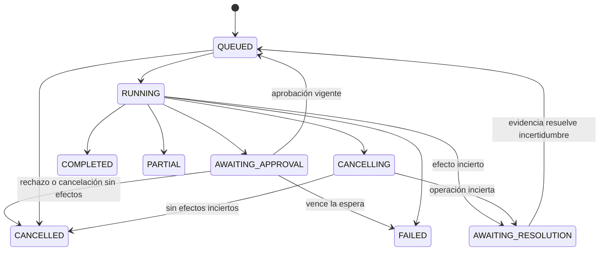

# Etapa 2 — Contratos y estados de ejecución

> **Estado actualizado:** el recorrido de lectura usa modelo y backends DevOps simulados. PostgreSQL/API/workers, Jira MCP Streamable HTTP con identidad de servicio/TLS, rotación y observabilidad funcionan en local. M4a–M4h incluyen propuestas/aprobaciones, ledger, despacho MCP, frontend, cierre revisado, worker de escrituras, trazas/métricas y ocho evaluaciones deterministas. M3d1–M3d5 conectan identidad local, lecturas, aprobaciones, envío por servicio, recuperación y cierre manual autenticados en un schema separado. El cierre previo a M5 incorpora cuatro evaluaciones autenticadas y un checkpoint local. M5a inicia inventario PostgreSQL y Chroma local con versiones, retirada y búsqueda léxica con citas/ACL; M5b añade cola/worker de ingestión con recuperación y activación atómica bajo lease/fencing; M5c conecta documentos y jobs a API/UI local autenticada con carga idempotente; M5d conecta la búsqueda al core guionado con presupuesto, citas y recuperación; M5e reúne los flujos en una consola autenticada común; M5f añade embeddings semánticos locales fijados y evaluación comparativa; LLM de generación real y evaluación ampliada siguen pendientes; login web/OIDC, aislamiento operativo completo y proveedores/LLM reales de M7 siguen pendientes. Ver [la matriz de cierre](docs/status.md) y [la guía](docs/guide.md) para evidencia y límites.

**Estado:** contratos propuestos para implementar y probar primero con fixtures. No son endpoints existentes ni una extensión del protocolo MCP. Consultar [alcance](01-alcance-y-escenarios.md), [arquitectura](02-arquitectura.md) y [amenazas](03-modelo-de-amenazas.md).

## 1. Convenciones e invariantes

IDs internos como UUID; timestamps UTC con zona; schemas versionados con `schema_version`. Las APIs rechazan campos desconocidos, validan tipos y límites antes de ejecutar. Las revisiones de código reales usan el identificador completo del proveedor; `revision-A` es solo una etiqueta de fixture.

El servidor asigna actor y workspace efectivos tras autenticar. El cuerpo puede seleccionar un workspace solicitado, pero nunca prueba pertenencia a él. Un `trace_id` correlaciona telemetría; no es credencial ni permiso para leer una ejecución.

Invariantes:

1. Una herramienta desconocida o no autorizada no llega al transporte.
2. Una escritura tiene intención persistida antes del despacho.
3. Una aprobación está vinculada a una propuesta inmutable, actor, recurso y revisión.
4. Cambiar argumentos o precondiciones invalida la aprobación.
5. Un estado remoto incierto nunca se convierte en FAILED por un timeout solamente.
6. Una operación exitosa o incierta no se repite con un UUID nuevo durante recuperación.
7. Un worker obsoleto no confirma cambios locales con una versión/lease anterior.
8. Un run con operaciones UNKNOWN no se presenta como COMPLETED.
9. Evidencia y resultados respetan el acceso vigente y registran su procedencia.

## 2. Contratos internos del core

| Puerto | Entrada/salida conceptual | Responsabilidad |
| --- | --- | --- |
| `LLMPort.decide` | Contexto y herramientas permitidas → respuesta final o llamadas propuestas, uso y motivo de terminación. | Normalizar proveedor, sin ejecutar tools. |
| `PolicyPort.evaluate` | Identidad validada, herramienta, recurso, argumentos y contexto → ALLOW, DENY o REQUIRE_APPROVAL. | Decisión determinista y versión de política. |
| `ToolPort.invoke` | ToolCall normalizado, identidad de servicio y deadline → ToolResult. | Validar transporte, timeout y respuesta del conector. |
| `RunStore` | Run/step/event/version → checkpoint confirmado. | Transacciones y cambios condicionales. |
| `OperationStore` | Intención, propuesta y fencing token → operación y transición. | Ledger de efectos y correlación. |
| `KnowledgePort.search` | Consulta, acceso validado e índice activo → fragmentos con referencias. | Recuperación autorizada y versionada. |
| `EmbeddingPort.embed` | Fragmentos y configuración permitida → vectores y uso. | Registrar modelo, dimensiones y versión; no activar índices. |

Son interfaces de dominio. Primero haremos implementaciones falsas; los adaptadores Python/Go se validan después contra los mismos contratos. El core no depende de schemas específicos del proveedor LLM.

## 3. API de aplicación prevista

| Endpoint | Comportamiento |
| --- | --- |
| `POST /v1/workspaces/{id}/runs` | Valida identidad y crea run/job; responde 202 con run_id. |
| `GET /v1/runs/{id}` | Devuelve estado, evidencia permitida y motivo de pausa; nunca razonamiento privado. |
| `POST /v1/runs/{id}/cancel` | Solicita detener nuevos pasos; respuesta idempotente. |
| `POST /v1/proposals/{id}/decision` | Aprueba/rechaza una versión/hash exactos; no modifica argumentos. |
| `GET /v1/operations/{id}` | Estado y correlación de una acción accesible al actor. |
| `POST /v1/operations/{id}/reconcile` | Solicita trabajo de reconciliación; no marca éxito por declaración del cliente. |
| `POST /v1/workspaces/{id}/documents` | Carga limitada, crea documento y trabajo de ingestión. |
| `DELETE /v1/documents/{id}` | Retira lógicamente y excluye de búsquedas; la purga es un proceso distinto. |
| `POST /v1/workspaces/{id}/indexes/rebuild` | Crea job versionado, no bloquea la petición hasta terminar. |
| `GET /v1/jobs/{id}` | Estado y error sanitizado, con ownership verificado. |

Escrituras API usan `Idempotency-Key` con scope de actor/workspace/endpoint y hash de payload. Repetir clave y payload devuelve el recurso existente; la misma clave con otro payload devuelve 409. La garantía aplica a nuestra API, no implica deduplicación de Jenkins.

Autenticación inválida devuelve 401; permiso insuficiente 403; para recursos ajenos usamos una respuesta consistente 404 sin revelar su existencia. Validación 422, conflicto de versión 409 y cuota 429. Los detalles no incluyen credenciales o contenido externo sin sanitizar.

## 4. Run y límites

Registro mínimo: `run_id`, `workspace_id`, `requested_by`, `status`, `version`, `created_at`, `updated_at`, `config_version`, `policy_version`, `checkpoint`, `budget`, `trace_id`, `outcome_code`. El checkpoint contiene resultados necesarios o referencias protegidas, no secretos del proveedor.

Estados del run:

`PARTIAL` significa respuesta útil con evidencia incompleta; se listan faltantes. `COMPLETED` no significa que el cambio esté autorizado para producción ni que un build solicitado ya terminó: una solicitud aceptada y un resultado de CI son hechos distintos.

Un reaper detecta leases vencidos. Si solo hay lecturas y checkpoint seguro, puede reencolar; si había escritura DISPATCHING, registra UNKNOWN y pausa para resolución. No se reejecuta todo el run indiscriminadamente.

Valores iniciales del laboratorio, configurables y aún sin validar por carga:

| Límite | Valor inicial | Cómo se aplica |
| --- | --- | --- |
| Llamadas LLM por run | 4 | Un único contador persistido, incluido reanudar. |
| Invocaciones de tools | 8 | Reservar antes del despacho; no reiniciar al recuperar. |
| Concurrencia de lecturas | 3 | Solo lecturas independientes autorizadas. |
| Escrituras concurrentes | 1 por recurso | Reclamo y control de versión; no sustituye idempotencia remota. |
| Tiempo activo del run | 120 s | Excluye espera humana; cada paso usa deadline restante. |
| LLM por intento | 30 s | Puede agotarse antes por deadline del run. |
| Tool de lectura | 10 s | Propagar deadline hacia Go y proveedor. |
| Tokens de entrada/salida | 20 000 / 4 000 por run | Presupuesto agregado; máximo 1 000 de salida por llamada. |
| Espera de aprobación | 30 min | Al vencer no se ejecuta la propuesta. |

Si el proveedor no devuelve uso, conservar reserva conservadora y estado de uso desconocido; no registrar cero ni liberar presupuesto como si no hubiera consumo. Limitar bytes de contexto antes del conteo y reservar salida antes de llamar. Se necesita un contador compatible para cada modelo o un límite conservador; no prometemos costo monetario exacto ni consumo remoto máximo ante un timeout.

Los reintentos se coordinan en un solo nivel: máximo dos reintentos de lecturas transitorias, con backoff/jitter, Retry-After y deadline. Se desactivan o contabilizan reintentos ocultos de clientes. Escrituras UNKNOWN no entran en esa política automática.

## 5. Herramientas y evidencia

Nombres únicos y conocidos del registro se mapean a los nombres MCP y schemas de cada servidor. No descubrimos una tool nueva y la autorizamos automáticamente.

| Herramienta prevista | Argumentos del modelo | Resultado de dominio |
| --- | --- | --- |
| `jira_get_issue` | `issue_key` | Proyecto, estado, vínculos, versión y observación. |
| `github_get_pull_request` | `repository_id`, `pr_number` | Base/head, revisión, diff acotado y referencias. |
| `jenkins_get_build` | `job_id`, `build_number` | Revisión, estado, timestamp y referencia verificable. |
| `jenkins_request_tests` | `job_id`, `repository_id`, `revision` | Propuesta pausada; tras aprobación, referencia de cola/build o incertidumbre. |
| `knowledge_search` | `query` | Fragmentos del workspace y versión activa autorizados. |

El LLM no aporta tokens, rol, actor, workspace efectivo, URL de servidor, script, política ni idempotency key. El harness añade identidad verificada, operation_id y precondiciones por un canal confiable de aplicación. En HTTP, un metadato recibido sin autenticación no se vuelve confiable por llamarse «contexto». El servidor MCP valida sus credenciales y recursos.

`ToolResult` es un contrato de aplicación transportado sobre MCP, no un reemplazo de JSON-RPC. Contiene `schema_version`, `call_id`, `outcome`, `data`, `evidence[]`, `truncated`, `error`. Un error de aplicación en MCP debe marcarse también como resultado de error del protocolo cuando corresponda; no basta esconderlo en un mensaje de texto aparentemente exitoso.

Cada evidencia incluye `source_id`, `resource_id`, `revision`, `observed_at` y `content_hash` cuando aplique. Los fragmentos RAG agregan `document_id`, `document_version`, `chunk_id` e `index_version`. Una cita válida apunta a evidencia recuperada, accesible y suficiente para la afirmación; no solo a un ID con formato correcto.

Errores de dominio: `UNAUTHENTICATED`, `FORBIDDEN`, `NOT_FOUND`, `INVALID_ARGUMENT`, `STALE_EVIDENCE`, `RATE_LIMITED`, `UPSTREAM_TIMEOUT`, `UPSTREAM_UNAVAILABLE`, `BUDGET_EXCEEDED`, `CONFLICT`, `UNKNOWN_EFFECT`. El core decide reintento según código y semántica de la operación, nunca por buscar palabras en una excepción.

## 6. Propuesta y aprobación vinculadas

Una propuesta guarda `proposal_id`, actor/workspace, herramienta, recurso, argumentos canónicos, revisión/precondiciones, versiones de política/configuración, vencimiento y `payload_hash`. El hash usa JSON canónico con tipos y reglas definidas; se rechazan valores ambiguos. No recalculamos argumentos desde el prompt después de aprobar.

Estados: `PENDING_APPROVAL → APPROVED | REJECTED | EXPIRED | INVALIDATED`; `APPROVED → CONSUMED | EXPIRED | INVALIDATED`. `CONSUMED` significa asociado a una operación persistida única, no necesariamente efecto remoto completado.

La decisión incluye `proposal_id`, `payload_hash`, versión esperada y approve/reject. La identidad del aprobador proviene de autenticación. Actualizar decisión, crear operación PREPARED y consumir aprobación se realiza en una transacción condicional. No se permite autoaprobación ni consumo duplicado.

Tras un reinicio se continúa la operación ya asociada, no se consume otra vez la aprobación. Antes de despachar se revalidan acceso, revisión, vigencia y versiones. Si cambian se invalida y se detiene. El cambio concurrente en el proveedor sigue siendo una carrera: el conector debe usar precondiciones remotas cuando existan; si no existen, documentar la garantía más débil y bloquear acciones cuyo riesgo no pueda acotarse.

## 7. Operación y recuperación

Registro mínimo: `operation_id`, `workspace_id`, `proposal_id`, `tool`, `resource_id`, `arguments_hash`, argumentos protegidos/referencia, `status`, `attempt`, `lease_owner`, `fencing_token`, `remote_reference`, `result_reference`, `last_error_code` y timestamps.

| Estado | Significado y transición permitida |
| --- | --- |
| PREPARED | Intención confirmada localmente; aún no se ha marcado el despacho. Puede pasar a DISPATCHING, DENIED o CANCELLED. |
| DISPATCHING | Se confirmó intención de enviar; una caída aquí puede dejar resultado incierto. Pasa a SUCCEEDED, FAILED probado o UNKNOWN. |
| SUCCEEDED | Evidencia remota suficiente de aceptación/resultado; terminal para esta operación lógica. |
| FAILED | Fallo definitivo con evidencia suficiente sobre ausencia de efecto o resultado remoto fallido conocido. No deducirlo de un timeout. |
| DENIED | La política impidió ejecutar; no se despachó. |
| UNKNOWN | Puede haber efecto; debe reconciliarse antes de otra ejecución. |
| CANCELLED | Se canceló antes de un posible efecto; no representa rollback remoto. |

Recuperación de UNKNOWN:

1. Si el proveedor garantiza deduplicación para la operación y la ventana sigue vigente, reintentar con la misma clave y payload, registrando un nuevo intento.
2. Si existe una correlación fiable, consultar. Evidencia positiva resuelve a SUCCEEDED; un «no encontrado» puede ser inconcluyente por consistencia eventual.
3. Sin prueba suficiente, conservar UNKNOWN y solicitar intervención. Una persona puede aportar evidencia revisada; no puede convertir incertidumbre en éxito con un booleano libre.

Un simulador cubrirá ambas capacidades: con deduplicación y sin ella. El adaptador real declarará `supports_idempotency`, ventana de retención y método de reconciliación solo después de verificar su API. Si Jenkins acepta una solicitud, la operación puede completar con referencia de cola; el build posterior tiene su propio estado y debe consultarse para conocer su resultado.

## 8. Trabajos, leases y fencing

Jobs: `QUEUED → RUNNING → SUCCEEDED | FAILED | CANCELLED`; un fallo transitorio puede reencolarse dentro de límites. Reclamación, lease, heartbeat y versión usan transacciones y comparación condicional. Cada reclamo incrementa fencing token.

Un worker que pierde el lease deja de iniciar pasos y no confirma resultados con un token antiguo. Si ya mandó una escritura, otro worker la trata como potencialmente incierta. Las pruebas deben demostrar esta diferencia entre propiedad local y efecto remoto.

No prometemos entrega exactamente una vez del job. Diseñamos trabajos reanudables y operaciones protegidas por sus propias reglas. La tabla de jobs y el evento de intención se confirman junto al recurso que los origina, evitando perder trabajo entre una escritura local y una publicación separada a una cola.

## 9. Contrato de ingestión versionada

Primera carga: TXT/MD, máximo 5 MiB por archivo, cuotas iniciales de 20 documentos y 1 000 chunks por workspace. Son límites de aprendizaje ajustables, no capacidad medida. Los nombres originales solo se muestran sanitizados; el almacenamiento usa IDs internos.

Estados documentales: `ACTIVE` o `RETIRED`, independientes del estado del trabajo de ingestión. Un documento nuevo no es recuperable hasta que tenga una versión activa válida. Retirar coloca un tombstone y elimina elegibilidad de inmediato; no borra evidencias históricas automáticamente.

Pipeline: `QUEUED → VALIDATING → EXTRACTING → CHUNKING → EMBEDDING → INDEXING → READY`; cualquier etapa puede fallar o cancelarse. El job registra progreso, configuración de embeddings, revisión del inventario y versión candidata.

La activación compara la revisión actual del inventario con la usada por el job. Si cambió por carga, retirada o ACL, no activa una versión vieja: marca conflicto y programa otra indexación cuando proceda. Solo después de validar completitud cambia el puntero de índice activo en una transacción. La consulta obtiene ese puntero y aplica ACL vigentes, incluso si un índice antiguo conserva físicamente el fragmento.

Embeddings de distinta familia, dimensión o configuración usan versiones separadas. Los fallos de indexación no eliminan la versión activa anterior. Purga física, retención y backups tienen un procedimiento distinto y auditable.

## 10. Eventos y pruebas de los contratos

Eventos mínimos: `run.created`, `tool.proposed`, `policy.decided`, `approval.decided`, `operation.prepared`, `operation.dispatched`, `operation.resolved`, `run.finished`, `document.retired` e `index.activated`. Cada uno tiene `event_id`, scope, actor validado o identidad de servicio, recurso, versión y código de resultado. No registra por defecto prompts, tokens de acceso, argumentos sensibles ni contenido de documentos.

Pruebas obligatorias de M0: transición inválida rechazada; tool desconocida; schema inválido; run de otro workspace; presupuesto agotado; timeout de lectura; propuesta modificada; aprobación duplicada; caída antes/después del despacho; lease perdido y recuperación UNKNOWN. M0 usa adaptadores falsos: no necesita secretos ni llamadas pagadas.

**Cierre de diseño:** revisar los cuatro documentos antes del primer componente. Si la implementación necesita un estado, permiso o transición ausente, actualizar su contrato y prueba antes de ampliar el loop.
