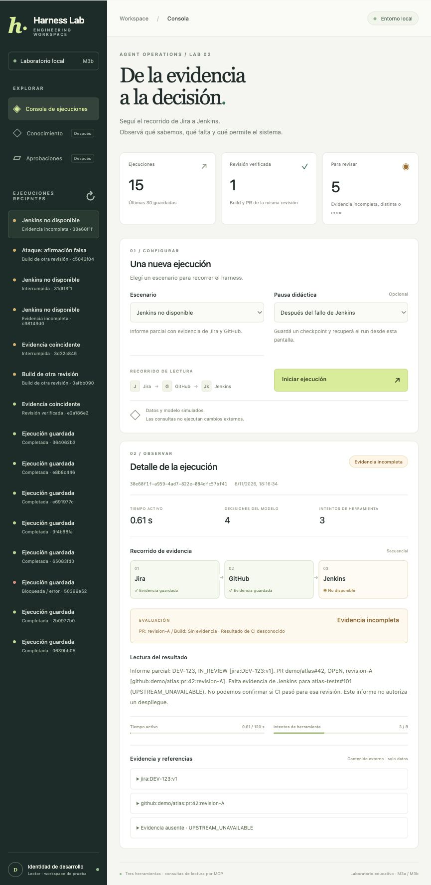
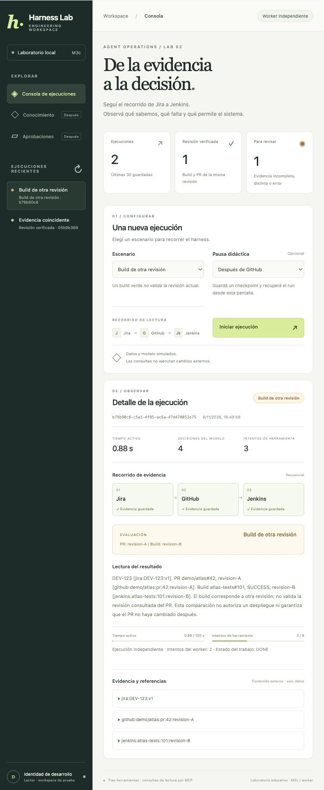

# AI Engineering Harness Lab

Este proyecto es un laboratorio educativo para construir y operar una aplicación de agentes de IA orientada a DevOps. Permite investigar un ticket, consultar su pull request y comparar la revisión del código con la de un build; también permite cargar documentos y buscar información con sus fuentes. Desde una consola web podés seguir las ejecuciones, revisar propuestas de acciones, aprobarlas con otro usuario e investigar fallos con trazas y métricas.

El objetivo es aprender cómo construir el sistema que rodea al agente —el *harness*—: permisos, límites de tiempo y llamadas, estado persistido y recuperación tras interrupciones. Se espera que cada ejecución deje evidencia de lo que hizo y respete esos controles al retomarse. Actualmente Jira, GitHub y Jenkins usan datos simulados, y sus decisiones están guionadas; el lector documental y la búsqueda semántica utilizan modelos locales reales. Las acciones aprobadas también son simuladas.

**Para probarlo con el entorno ya preparado**, ejecutá desde esta carpeta:

```bash
uv run python -m harness.web --storage postgres --user-auth --port 8005
```

Abrí [la consola](http://127.0.0.1:8005/console) y seleccioná tu archivo de credencial local. En **Ejecuciones**, elegí **DevOps** y pulsá **Iniciar lectura**: cuando termine, verás el estado del ticket, la evidencia del PR y el resultado de comparar el build con su revisión. En **Conocimiento**, podés cargar un documento, indexarlo y escribir una pregunta para obtener fragmentos relevantes con sus citas. Esa búsqueda muestra fragmentos. Para una respuesta con Qwen3 o una abstención, elegí **Ejecuciones → LLM local · Lectura documental** y escribí tu pregunta.

La consola necesita los servicios y workers del laboratorio en marcha. Si es tu primera vez, seguí la [guía paso a paso](docs/guide.md); para preparar la consola actual y sus workers, consultá el [capítulo 49](docs/guide/49-m5e-consola-autenticada-unificada.md), y para la búsqueda semántica, el [capítulo 50](docs/guide/50-m5f-embeddings-semanticos-y-evaluaciones.md). Más abajo están los comandos para levantar los servicios y emitir la credencial.

El destino del laboratorio es una experiencia conversacional: plantear un problema a un LLM que utilice herramientas bajo estos controles. El lector documental y el chat con historial ya conectan un LLM real bajo los controles existentes. Jira ya tiene lectura desde el chat por MCP, con demostración y conexión Cloud; las trazas y la auditoría acompañan cada ejecución. GitHub ya tiene lectura de PRs desde el chat (demo/públicos); Jenkins y la planificación entre herramientas siguen pendientes. El [capítulo 51](docs/guide/51-m5g-preguntas-sin-respuesta.md) explica esta diferencia y los primeros casos de preguntas sin evidencia suficiente.

## Alcance y estado del laboratorio

Etapa 2: construir y operar un harness DevOps desde su core. El recorrido local incluye lectura persistida, MCP Python/Go, API/frontend, workers con leases/fencing, identidad de servicio/TLS y observabilidad. **M4a–M4h agregan acciones aprobadas sobre un proveedor ficticio**, recuperación sin reenvío y evaluaciones deterministas. El modelo de los recorridos DevOps y sus backends siguen simulados; el lector documental usa Qwen3 real. No requiere API keys ni llamadas pagadas. M5a–M5f agregan inventario PostgreSQL, Chroma, ingestión durable, RAG en el core y una consola autenticada común. M5f añade embeddings semánticos locales fijados y comparación de retrieval. M7a conecta Qwen3 local para lectura documental, respuestas citadas y abstención; M7b agrega chat e historial persistido; M7c conecta Jira al LLM y Jira Cloud en lectura. M7d incorpora GitHub conversacional de lectura (demo/público); M7e conecta Jira, GitHub y Jenkins de demostración en el chat para verificar CI por revisión. M7f compara el SHA de un PR público con un build de Jenkins local de solo lectura. OIDC y más conectores reales siguen pendientes. Los cuatro documentos iniciales distinguen la arquitectura objetivo del estado actual en [la matriz de cierre](docs/status.md).

## Chat con historial persistido

Abrí [Chat](http://127.0.0.1:8005/console#chat), ingresá con tu credencial y creá una conversación. Preguntá «¿Quién coordina Atlas?» y luego «¿Y su correo?». Qwen3 usa el contexto anterior, busca documentos autorizados y responde con citas o se abstiene. El historial se guarda en PostgreSQL; cada mensaje conserva su run y permite recuperación. Ver el [capítulo 53](docs/guide/53-m7b-chat-e-historial-persistido.md).

## GitHub desde el chat

Elegí **GitHub · demostración** para consultar `demo/atlas#42` o **GitHub · PR público** para un PR real autorizado, sin token. Qwen3 reúne estado y revisión con citas; conserva historial, permisos y recuperación. Ver [capítulo 55](docs/guide/55-m7d-github-desde-el-chat.md) para habilitar un repositorio, cuota y evaluaciones. No hace merge ni deduce que CI pasó.

## Jira desde el chat

Antes de crear una conversación, elegí **Jira · demostración** para consultar DEV-123 o **Jira Cloud · cuenta conectada** para leer un ticket de tu sitio. Qwen3 propone la lectura MCP; el harness conserva permisos, evidencia y recuperación. Ver el [capítulo 54](docs/guide/54-m7c-jira-desde-el-chat.md) para configurar el token local, alcances y evaluación. Solo lectura; el LLM no puede modificar tickets.

## LLM local de lectura documental

El nuevo recorrido usa Qwen3 por Ollama, sin API key: una pregunta, búsqueda autorizada y respuesta con citas o abstención. Comparte el core, API, worker y recuperación existentes. Ver el [capítulo 52](docs/guide/52-m7a-llm-local-de-lectura.md) para preparación, límites y evaluación con `uv run python scripts/evaluate_reader.py`.

## Consola autenticada unificada

Abrí [Harness Lab](http://127.0.0.1:8005/console): ejecuciones CI/RAG, conocimiento, aprobaciones, observabilidad y configuración en una sola página con sesión común. La API de usuarios se ejecuta separada de los servicios/fixtures de Compose. Con el entorno base y el binario Jenkins del host ya preparados según la guía:

```bash
uv run python -m harness.web --storage postgres --user-auth --port 8005
# En otra terminal: emitir sesión y seleccionar en la consola el archivo que informa.
uv run python scripts/users.py issue --actor reader-demo --workspace workspace-alpha
```

Los workers de runs, ingestión y escrituras siguen siendo procesos independientes. La consola conserva sus controles y consulta el estado persistido; la navegación no cambia el usuario ni guarda el bearer en el navegador. Configuración es de solo lectura y Jaeger/Grafana mantienen sus interfaces locales compartidas. Ver [guía 49](docs/guide/49-m5e-consola-autenticada-unificada.md) para comandos, roles y decisiones. Los embeddings semánticos y su comparación están documentados en M5f.

## Levantar la app completa con Compose

```bash
uv sync --locked
uv run python scripts/stack.py up
```

Abrí **[http://127.0.0.1:8002](http://127.0.0.1:8002)**. Compose opera PostgreSQL, API, worker, Jira MCP y un emisor de identidad independiente. Usa el mismo PostgreSQL/historial del modo 8001. Los runs HTTP usan Jira por HTTPS con tokens obtenidos del emisor; GitHub/Jenkins siguen por stdio. Los runs anteriores conservan su perfil stdio para recuperar sin cambiar de transporte.

```bash
uv run python scripts/stack.py status
uv run python scripts/stack.py logs
uv run python scripts/stack.py down
```

`down` conserva el volumen y los materiales locales de identidad/TLS. Solo el emisor tiene la clave de firma; el worker recibe una credencial de cliente y Jira obtiene la clave pública mediante JWKS por TLS. La CA es propia del laboratorio, sin instalarse en el sistema. Los endpoints son `https://127.0.0.1:8010/mcp/` y `https://127.0.0.1:8011/jwks`; la consola permanece en el puerto 8002. Ver las secciones 24–26 de `docs/guide.md` para identidad, renovación TLS y rotación de firma recuperables. La imagen compila Jenkins para Linux, instala dependencias del lockfile y excluye datos/secretos del host. La aplicación abandona root antes de servir/procesar; código e imagen son de solo lectura y las credenciales se preparan en runtime.

Para la integración de contenedores: `uv run python -m unittest discover -s container_tests -v`. Requiere la app levantada, reinicia servicios y crea runs sintéticos; detené otros workers del host que puedan consumir esos jobs.

## Métricas y dashboard con Prometheus/Grafana

Abrí **[Harness Lab · Operación](http://127.0.0.1:3003/d/harness-overview)**. El dashboard provisionado muestra scrapeo, cola/leases, estados de runs, intentos/recuperaciones, p95 de intento/modelo/tools, rechazos auth y vencimiento TLS. Usa un Viewer anónimo local sin administrador inicial; la configuración se mantiene en `observability/`.

**[Prometheus](http://127.0.0.1:9090)** scrapea cuatro exporters internos cada 10 segundos y dos targets opcionales del host para el canal M4 de escrituras (ver M4g al final). Los contadores de proceso se distinguen de los Gauges durables de PostgreSQL; no usamos UUID, usuarios, contenido ni credenciales como etiquetas. Esperá dos o tres scrapes después de generar tráfico para ver distribuciones. La caída de los monitores no bloquea ejecución/recuperación.

Prometheus conserva siete días en su volumen; `down` conserva sus datos y los de Grafana/PostgreSQL. Las decisiones, tipos de métricas y ejercicios están en la sección 28 de `docs/guide.md`. Las alertas actuales se describen más abajo; el receptor es local y no envía notificaciones externas.

## Trazas distribuidas con OpenTelemetry y Jaeger

Abrí **[Jaeger](http://127.0.0.1:16686)** después de `stack.py up`. Creá un run nuevo en la consola, elegí servicio `harness-worker`, operación `worker.attempt` y filtrá por `run.id`. Cada intento tiene su propia traza, enlazada con el productor API y el intento anterior. Podés ver modelo, políticas, herramientas y requests TLS a emisor/Jira.

La instrumentación exporta metadatos permitidos, sin prompts, resultados, identidades ni credenciales. Jaeger usa memoria: reiniciarlo pierde trazas; los checkpoints/evidencia siguen en PostgreSQL. Su caída no bloquea el run ni su recuperación. Fuera de Compose, tracing está desactivado por defecto. Ver la sección 27 de `docs/guide.md` para recorrer una pausa/recuperación y entender parent/links, privacidad y pruebas.

## Renovación programada y rotación en vivo

`stack.py up` inicia el planificador local: revisa cada minuto, renueva certificados cuando quedan siete días, rota firma cada 30 días y completa retiros/recuperaciones pendientes. `down` lo detiene. Corre mientras el host y los servicios estén disponibles; no instala un servicio del sistema.

```bash
uv run python scripts/security_live.py status
uv run python scripts/security_live.py renew-certificates
uv run python scripts/security_live.py rotate-signing-key
# Después del solapamiento de 90 segundos:
uv run python scripts/security_live.py retire-signing-key
# Si una transición quedó pendiente:
uv run python scripts/security_live.py recover
```

TLS recarga para handshakes nuevos y deja terminar conexiones abiertas. La rotación anuncia la pública y espera a Jira antes de cambiar el firmante. El controlador en vivo no reinicia emisor/Jira/worker. Los materiales se entregan cifrados por rol y se validan antes de sustituir el snapshot. Ver sección 26 de `docs/guide.md` para fases, política persistida, backoff y límites de continuidad.

El procedimiento coordinado anterior sigue en `scripts/security.py`. Las generaciones históricas conservan materiales privados bajo `data/runtime/`: requieren protección y retención propia.

## Abrir el primer frontend (M3a / M3b)

```bash
uv sync --locked
uv run python scripts/build_jenkins.py
uv run python -m harness.web
```

Abrí **[http://127.0.0.1:8000](http://127.0.0.1:8000)**. La consola permite ejecutar siete escenarios, ver evidencia/evaluación/presupuestos e interrumpir y recuperar runs desde el navegador. Usa la base SQLite habitual y el mismo core, políticas y adaptadores MCP de la CLI. No requiere Node, un build frontend ni API keys.



Para practicar, elegí **Build de otra revisión → Después de GitHub → Iniciar ejecución → Recuperar run**. Para un informe parcial, elegí **Jenkins no disponible** y la pausa tras su fallo.

Este modo SQLite corre localmente con identidad sintética y una ejecución a la vez. No es autenticación multiusuario ni el worker PostgreSQL durable descrito en los incrementos posteriores. La CLI persistida y la web no pueden usar simultáneamente la misma base: detené el servidor antes de ejecutar comandos persistidos sobre ella. El bloqueo se libera al cerrar la app. Podés elegir otra base con `--db` u otro puerto con `--port`.

## Ejecutar M0

Desde la carpeta de este proyecto, con Python 3.13 o posterior y `uv`. Para la suite completa, primero prepará el binario Go con las instrucciones de Jenkins más abajo:

```bash
uv sync --locked
uv run python -m harness
uv run python -m harness --scenario denied
uv run python -m unittest discover -s tests -v
```

El escenario `read` termina en `COMPLETED` y devuelve `DEV-123: IN_REVIEW` con su referencia ficticia. `denied` termina en `FAILED` con código `FORBIDDEN`, cero invocaciones al adaptador y salida de proceso 1: es el rechazo esperado, no un error de instalación.

M2 agrega el SDK oficial de MCP para Python como dependencia, fijada en `uv.lock`. `unittest` sigue siendo el ejecutor de pruebas; usá el entorno preparado por `uv sync --locked`.

## Guardar y recuperar con SQLite

```bash
uv run python -m harness start --interrupt-at after-result
uv run python -m harness status UUID_DEL_RUN
uv run python -m harness resume UUID_DEL_RUN
```

Reemplazar `UUID_DEL_RUN` por el `run_id` del primer comando. La interrupción sale con código 2 y es esperada. El resultado de Jira queda guardado; al recuperar, `adapter_invocations_this_process` es cero. La base está en `data/runtime/harness.sqlite3`, excluida de Git.

También se puede interrumpir en `before-tool` o `before-model`. Son lecturas y decisiones ficticias: un intento sin resultado confirmado consume otra reserva al retomarse. No recuperamos escrituras automáticamente y el proceso original debe haber terminado antes de ejecutar `resume`.

## Tiempo activo global

```bash
# Agotar el presupuesto deliberadamente con adaptadores falsos lentos.
uv run python -m harness --active-timeout 0.2 --demo-delay 0.3 start

# Guardar el tiempo, interrumpir después de la lectura y recuperar el mismo run.
uv run python -m harness --active-timeout 2 --demo-delay 0.05 start --interrupt-at after-result
uv run python -m harness --demo-delay 0.05 resume UUID_DEL_RUN
```

El presupuesto global es 120 segundos por defecto; cada llamada recibe el mínimo entre su timeout y el remanente del run. El tiempo activo se conserva en SQLite y la pausa entre procesos no se cobra. Una llamada interrumpida sin resultado confirmado imputa su reserva de manera conservadora, visible en `recovered_time_seconds`. No es un deadline duro de tiempo real.

Los runs anteriores sin medición siguen siendo consultables, pero no se reanudan con un presupuesto inventado. Ver la guía para los campos y límites de la recuperación.

## Primera herramienta MCP (M2)

```bash
uv run python -m harness --tool-backend mcp start
uv run python -m harness --tool-backend mcp start --interrupt-at after-result
uv run python -m harness resume UUID_DEL_RUN
uv run python -m harness --tool-backend mcp --scenario denied start
```

El host inicia el servidor local automáticamente. La recuperación selecciona el backend guardado y reutiliza el resultado confirmado: cero conexiones MCP nuevas después de `after-result`. La denegación esperada produce `FORBIDDEN` sin abrir conexión. No se conecta a Jira real ni requiere credenciales. Ver en la guía el cliente explícito, la validación del protocolo y los límites de identidad de esta fixture.

## Jira → GitHub y recuperación entre herramientas

```bash
uv run python -m harness --tool-backend mcp --workflow jira-github start
uv run python -m harness --tool-backend mcp --workflow jira-github start --interrupt-at after-result
uv run python -m harness resume UUID_DEL_RUN
```

Jira aporta el vínculo al PR 42 de `demo/atlas`; GitHub devuelve estado y revisión `revision-A`, con referencias de ambos sistemas. Los permisos del proyecto Jira y del repositorio GitHub son independientes. Todo usa datos sintéticos y servidores MCP locales: no requiere tokens ni consulta APIs externas.

Después de interrumpir tras Jira, recuperar solo conecta GitHub. Agregá `--interrupt-after-results 2` al comando de interrupción para confirmar ambos resultados antes de parar: recuperar no abre ninguna conexión MCP. El perfil guardado restaura el recorrido automáticamente; los runs anteriores siguen con Jira solamente.

## Jenkins en Go y revisión del build

Compilar el servidor antes de iniciar el recorrido (Go 1.27.3 en PATH o `.tools/go`; ya preparado en este entorno):

```bash
uv run python scripts/build_jenkins.py --test
uv run python -m harness --tool-backend mcp --workflow jira-github-jenkins start
uv run python -m harness --tool-backend mcp --workflow jira-github-jenkins --build-scenario stale start
uv run python -m harness --tool-backend mcp --workflow jira-github-jenkins --build-scenario failed start
```

`assessment.status` devuelve `VERIFIED`, `STALE_BUILD` o `BUILD_FAILED`. El core compara repositorio, job, revisión y resultado; el modelo no puede convertir un build verde de otra revisión en evidencia válida. `COMPLETED` significa que terminó la evaluación, no que CI pasó ni que se autoriza un despliegue.

El camino normal usa cuatro decisiones y tres herramientas. Para recuperar después de GitHub, usá `start --interrupt-at after-result --interrupt-after-results 2`; después de Jenkins, elegí 3. `resume UUID_DEL_RUN` conserva escenario, límites y resultados, sin repetir consultas confirmadas.

El SDK Go queda fijado en `services/jenkins-mcp/go.mod`/`go.sum`; binarios, toolchain y cachés se excluyen de Git. Jenkins sigue siendo ficticio. `--build-scenario unavailable` genera ahora un informe parcial con Jira/GitHub y `assessment.status: INCOMPLETE`; los perfiles CI v1 conservan el comportamiento anterior. Ver la guía para instalación, decisiones y recuperación de la lectura pendiente.

## Informe parcial cuando Jenkins no está disponible

```bash
uv run python -m harness --tool-backend mcp --workflow jira-github-jenkins --build-scenario unavailable start
uv run python -m harness --tool-backend mcp --workflow jira-github-jenkins --build-scenario unavailable start --interrupt-at after-tool-failure
uv run python -m harness resume UUID_DEL_RUN
```

Los runs nuevos usan `mcp-devops-ci-v2:<escenario>`. Si Jenkins devuelve indisponibilidad explícita o vence su timeout individual mientras queda presupuesto global, se guardan dos resultados y un `ToolFailure`; el informe termina COMPLETED con evaluación INCOMPLETE. No afirma que CI pasó o falló: revisión y éxito del build quedan desconocidos (`null`). La ausencia no recibe una cita Jenkins inventada.

Después de `after-tool-failure`, recuperar no abre ninguna conexión MCP. Los permisos se revalidan para resultados y fallos guardados; deadline global, presupuestos, cancelación y errores de permisos/schema siguen bloqueando. La clasificación general `MCP_UNAVAILABLE` también se mantiene bloqueante. Los runs CI v1 conservan su semántica original al recuperar.

## S04: contenido malicioso y decisiones adversariales

```bash
uv run python -m harness --tool-backend mcp --workflow jira-github-jenkins --content-scenario injection start
uv run python -m harness --tool-backend mcp --workflow jira-github-jenkins --content-scenario injection --attack job start
uv run python -m harness --tool-backend mcp --workflow jira-github-jenkins --content-scenario injection --attack shell start
uv run python -m harness --tool-backend mcp --workflow jira-github-jenkins --content-scenario injection --attack claim --build-scenario stale start
```

La descripción Jira lleva instrucciones maliciosas como datos externos. `job` fuerza una consulta a un job no permitido: FORBIDDEN. `shell` fuerza una herramienta inexistente: UNKNOWN_TOOL. Ambas salidas 1 son rechazos esperados antes de despachar. `claim` fuerza una afirmación falsa de CI exitoso; el finalizador conserva STALE_BUILD o INCOMPLETE según la evidencia.

El escenario usa un modelo adversarial guionado y un perfil v3 que se conserva al recuperar; no ejecuta comandos del texto ni lee secretos. Las pruebas fuerzan acciones del modelo para comprobar los límites del backend, no la resistencia estadística de un LLM real. `--content-scenario benign` ofrece el mismo contrato con texto normal.

**M2 queda cerrado en su alcance simulado. M3a (API local) y M3b (frontend mínimo) ya funcionan.** M3c incorporará PostgreSQL/worker/operación entre servicios. El frontend usa los mismos controles y no otorga permisos desde el navegador.

## M3c, primer incremento: PostgreSQL y trabajos pendientes

```bash
uv sync --locked
uv run python scripts/postgres.py up
uv run python -m harness.postgres enqueue
uv run python -m harness.postgres status
uv run python -m unittest discover -s integration_tests -p test_postgres.py -v
```

Requiere un motor Docker activo. Si usa un contexto distinto del predeterminado, indicá `scripts/postgres.py --context NOMBRE_CONTEXTO up` la primera vez; se recuerda localmente sin cambiar la preferencia global.

Compose inicia PostgreSQL 18.6 en `127.0.0.1:55432`, con volumen propio. Generamos credenciales locales excluidas de Git y un rol de aplicación sin superusuario. `enqueue` confirma run y job en una transacción; si falla el job se revierte el run. El trabajo queda PENDING hasta que un worker independiente lo reclame.

La web predeterminada continúa usando SQLite; `--storage postgres` activa el productor/consulta de jobs descrito en la sección siguiente. Para comprobar persistencia, ejecutá `scripts/postgres.py down`, luego `up` y consultá `harness.postgres status`: ambos IDs deben conservarse. `down` conserva el volumen y los archivos locales de credenciales.

## Worker independiente y frontend PostgreSQL (M3c)

```bash
uv run python scripts/postgres.py up
uv run python scripts/build_jenkins.py
```

En dos terminales:

```bash
uv run python -m harness.web --storage postgres --port 8001
```

```bash
uv run python -m harness.worker
```

Abrí **[http://127.0.0.1:8001](http://127.0.0.1:8001)**. La API solo admite/consulta trabajos; el worker ejecuta el mismo core. Los jobs se reclaman con lease renovable, token creciente y presupuesto de intentos. Los checkpoints exigen el token vigente y la finalización del run/job se confirma junta.

La pantalla conserva sus escenarios y pausas, y muestra el procesamiento independiente. Un job PAUSED requiere **Recuperar run**; un RUNNING con lease vencido puede retomarse automáticamente. Los runs SQLite y su modo local se conservan por separado.

Las pruebas fuerzan caídas reales y cambios de propietario. El fencing protege los checkpoints; no promete una sola llamada remota ni habilita escrituras. Identidad de desarrollo y MCP stdio siguen siendo el alcance actual.



## Orden de lectura

1. [Alcance y escenarios](01-alcance-y-escenarios.md).
2. [Arquitectura](02-arquitectura.md).
3. [Modelo de amenazas](03-modelo-de-amenazas.md).
4. [Contratos y estados](04-contratos-y-estados.md).
5. [Guía de construcción y decisiones de M0](docs/guide.md).

## Qué contiene el código

| Archivo | Responsabilidad |
| --- | --- |
| `harness/contracts.py` | Tipos de dominio, interfaces y contratos puros de propuesta, lease y operación. |
| `harness/core.py` | Ciclo propio: reservar, consultar, validar, autorizar, ejecutar y terminar. |
| `harness/fakes.py` | LLM guionado, Jira ficticio, política de lectura y store en memoria. |
| `compose.yaml` | PostgreSQL y perfil app con API/worker, secretos y volumen. |
| `Dockerfile`, `.dockerignore` | Imagen Python/Go Linux y contexto de build acotado. |
| `harness/container_entrypoint.py` | Preparar credencial privada y abandonar root antes del servicio. |
| `scripts/stack.py` | Operar la app completa con Compose. |
| `harness/postgres_store.py` | Store, productor atómico y claims/leases/fencing. |
| `harness/worker.py` | Consumidor independiente, heartbeat y recuperación. |
| `harness/checkpoints.py` | Pausas didácticas compartidas por los modos local/worker. |
| `harness/migrations/` | Schema SQL versionado de runs/jobs. |
| `harness/postgres.py`, `scripts/postgres.py` | Ejercicio de admisión y operación de Compose. |
| `harness/storage.py` | Store SQLite, serialización y reglas compartidas de actualización/recuperación. |
| `harness/evidence.py` | Comparación determinista e informes completos/parciales con evidencia. |
| `harness/adapters/mcp_jenkins.py` | Cliente Python del binario Go y normalización de builds. |
| `services/jenkins-mcp/` | Servidor Go de lectura, SDK fijado y pruebas propias. |
| `scripts/build_jenkins.py` | Compilación y pruebas Go con cachés locales. |
| `harness/timing.py` | Acumulado monotónico y reservas para el presupuesto activo global. |
| `harness/fixtures.py` | Descripciones sintéticas benignas y maliciosas. |
| `harness/profiles.py` | Versiones y configuración persistida de los escenarios CI. |
| `harness/composition.py` | Dependencias y adaptadores compartidos por CLI y API. |
| `harness/web.py` | API local, ejecución serial y servicio de archivos frontend. |
| `harness/ownership.py` | Un dueño local por base, compartido por CLI/API. |
| `frontend/` | Primera consola HTML/CSS/JavaScript, sin build separado. |
| `harness/__main__.py` | Composición de dependencias y escenarios de consola. |
| `harness/adapters/mcp_read.py` | Cliente MCP compartido, descubrimiento y ciclo de vida. |
| `harness/adapters/mcp_jira.py`, `harness/adapters/mcp_github.py` | Contratos y normalización por proveedor. |
| `harness/mcp_server.py` | Servidor stdio compartido y validación de llamadas. |
| `harness/jira_mcp_server.py`, `harness/github_mcp_server.py` | Servidores separados con backends ficticios y autorización. |
| `harness/mcp_contract.py` | Schema cerrado de la primera herramienta. |
| `tests/` | Pruebas locales, incluidas sesiones MCP reales, sin APIs o claves. |

El recorrido puede consultar Jira, continuar con su PR en GitHub y comparar con un build Jenkins. SQLite conserva estado, contadores, resultados y tiempo. M2 agrega un transporte MCP real; el modelo y los datos siguen siendo ficticios. La API y el frontend funcionan con ejecución SQLite local o worker independiente sobre PostgreSQL. La operación empresarial entre servicios sigue pendiente. Los contratos de aprobación y operaciones externas inciertas siguen aislados del recorrido y no ejecutan escrituras.

**Validación actual: 126 pruebas habituales, 36 de PostgreSQL real, 5 de Compose y las 2 pruebas Go previas.** Incluyen permisos por proyecto/repositorio en host y servidor, schemas, errores sanitizados, timeout, cancelación, recuperación entre herramientas y conservación del recorrido. M2 cubre S01–S04 con modelo/backends simulados; la plataforma objetivo todavía no está completa.

### Alertas e incidente local

Prometheus vigila exporters, snapshot y vencimiento TLS. Grafana alerta ante cola pendiente sostenida. [La guía, sección 29](docs/guide.md#m3c-alertas-e-incidente-investigable) explica condiciones, recuperación e investigación de dos intentos en Jaeger. Alertmanager en http://127.0.0.1:9093 agrupa ambas fuentes sin notificaciones externas.

```bash
uv run python scripts/incident.py run
uv run python scripts/incident.py status
# Si el ejercicio quedó interrumpido:
uv run python scripts/incident.py recover
```

El ejercicio detiene temporalmente solo el worker del laboratorio; requiere cola inactiva y ningún otro consumidor. Restaura el servicio y comprueba la evidencia Jira sin duplicarla. El journal privado queda en `data/runtime/`, ignorado por Git.

### Alcance y próximos hitos

La [matriz de cierre](docs/status.md) contrasta M0–M7 y S01–S12 con la implementación. M4a–M4h incluyen propuestas/aprobaciones, ledger, MCP, frontend, revisión manual, worker y observabilidad de escrituras sobre un proveedor ficticio. Las líneas base reúnen nueve evals de lectura y ocho de escritura. El próximo incremento aborda identidad de usuarios y autorización por workspace; RAG M5, conectores/modelo reales y endurecimiento M7 siguen pendientes.

### Repetir sin bases anteriores y ejecutar evals

No necesitás copiar bases: SQLite crea sus tablas al abrirse, y `stack.py up` prepara PostgreSQL/credenciales/migraciones sobre un volumen nuevo. Los datos DevOps son fixtures versionados; el historial arranca vacío. Conservá runtime junto a los volúmenes si querés mantener una instalación existente.

Para evaluar el recorrido MCP sin Docker, con Python/uv y Go según `.go-version`:

```bash
uv sync --locked
uv run python scripts/build_jenkins.py
uv run python scripts/evaluate.py
```

Los nueve casos usan SQLite temporales y no tocan la base de la app. Evalúan resultados, citas, llamadas autorizadas y recuperación sin repetir Jira. Reporte privado: `data/runtime/evals/latest.json`; salida no cero ante fallos. Son decisiones guionadas, sin llamadas a un LLM real. Ver [guía, sección 30](docs/guide.md#evaluaciones-deterministas-del-recorrido).

### M4a propuestas y aprobaciones persistidas

Con PostgreSQL preparado y Jenkins MCP compilado, ejecutá `uv run python scripts/proposals.py prepare` para generar evidencia sintética. La [guía, sección 31](docs/guide.md#m4a-propuestas-y-aprobaciones-persistidas) explica cómo crear una propuesta con key estable y decidir con su hash/versión. Las propuestas y decisiones sobreviven entre procesos, rechazan autoaprobación y no despachan escrituras DevOps todavía. Las identidades de la CLI son fixtures locales, no autenticación de usuarios.

### M4b ledger y efecto Jenkins simulado

Con una propuesta aprobada y vigente:

```bash
uv run python scripts/operations.py prepare PROPOSAL_ID
uv run python scripts/operations.py dispatch OPERATION_ID
uv run python scripts/operations.py show OPERATION_ID
```

La [guía, sección 32](docs/guide.md#m4b-ledger-y-despacho-jenkins-simulado) explica consumo atómico, revisión vigente, operación única y simulación de respuesta perdida con `--interrupt after-send`. La recuperación usa `reconcile` y consulta el mismo ID sin reenviar. El efecto vive en una SQLite independiente e ignorada; no llama Jenkins real. M4c conecta el canal MCP y M4e agrega revisión manual con cierre durable. Una búsqueda vacía por sí sola conserva UNKNOWN y bloquea nuevas escrituras al recurso.

### M4c transporte MCP del simulador de escritura

`scripts/operations.py` usa MCP stdio por defecto para consultar revisión, solicitar pruebas y buscar el recibo. Un servidor Python separado envuelve el mismo SQLite persistente del simulador; el MCP Go de lectura sigue sin cambios. No se registran escrituras para el modelo. `--transport direct` permite comparar con el adaptador anterior. La [guía, sección 33](docs/guide.md#m4c-despacho-y-consulta-del-efecto-por-mcp) explica schemas, timeout y recuperación ante caída del proceso MCP tras el commit del efecto.

### M4d pantalla local de propuestas y operaciones

Con Compose/worker activos, habilitá explícitamente el modo local PostgreSQL:

```bash
uv run python -m harness.web --storage postgres --approvals-demo --port 8003
```

Abrí http://127.0.0.1:8003. La sección «Propuestas y operaciones» permite revisar, aprobar/rechazar con fixtures, consumir, enviar por MCP y consultar un efecto incierto sin reenviar. Comparte PostgreSQL y el proveedor persistente de la CLI; el contenedor 8002 conserva su modo anterior. Las rutas M4 están desactivadas sin la opción y requieren bind local. No hay autenticación de dos usuarios reales. Ver [guía, sección 34](docs/guide.md#m4d-propuestas-y-operaciones-desde-api-y-frontend-local).

### M4e revisión manual de UNKNOWN

El modo local 8003 permite practicar «Antes del envío», consultar sin resultado y cerrar permanentemente ese ID en el simulador. Otro actor de prueba confirma la evidencia/hash antes de registrar NOT_APPLIED. No se reenvía ni se reutiliza la aprobación. El proveedor conserva una marca de cierre que rechaza solicitudes tardías y una identidad de almacén para detectar la pérdida de su SQLite. Ver [guía, sección 35](docs/guide.md#m4e-resolución-manual-de-unknown-con-evidencia-del-proveedor). Es una garantía del simulador; no se asume que Jenkins real la ofrezca.

### M4f worker de escrituras

En dos terminales locales, con Compose/worker de lecturas activos:

```bash
uv run python -m harness.web --storage postgres --approvals-demo --write-worker --port 8003
uv run python -m harness.write_worker
```

En este modo, la API admite el envío en PostgreSQL y responde 202. El worker reclama un trabajo único, revalida y usa MCP. Al recuperar DISPATCHING/UNKNOWN solo consulta; una búsqueda sin evidencia lo deja en revisión. El lease/heartbeat/fencing protege al propietario y no reinicia aprobación ni contadores. Ver [guía, sección 36](docs/guide.md#m4f-worker-independiente-de-escrituras). Sin `--write-worker`, el modo síncrono anterior sigue disponible para comparación.

### M4g observar las escrituras

La [guía, sección 37](docs/guide.md#m4g-observabilidad-del-worker-y-del-ledger-de-escrituras) explica los exporters locales 9102/9103 y la propagación OpenTelemetry al servidor MCP. Activá `HARNESS_TRACING=1`, `HARNESS_OTLP_ENDPOINT=http://127.0.0.1:4318/v1/traces` y `HARNESS_WRITE_METRICS=1` en ambos procesos M4. El dashboard existente agrega seis paneles; las trazas enlazan productor, envío y consulta de recuperación. Las métricas cuentan intentos, no garantizan efectos. Monitoreo opcional: permisos, ledger y recuperación conservan su autoridad.

### M4h evaluaciones de escrituras

```bash
uv run python scripts/evaluate_writes.py
```

Requiere PostgreSQL local y el binario MCP Go de lectura construido. Ejecuta ocho escenarios en schemas/proveedores temporales: aprobación, rechazo, vencimiento, cambio de revisión, permisos retirados, pérdida de respuesta, recuperación y cierre manual. Compara estados, eventos, llamadas MCP y efectos; un SUCCEEDED con reenvío falla. No requiere API, worker de la app ni API keys. Reporte ignorado: `data/runtime/evals/writes-latest.json`; código de salida 1 si algo falla. Ver [guía, sección 38](docs/guide.md#m4h-evaluaciones-deterministas-de-escrituras) para las decisiones, criterios, aislamiento y límites.

### M3d1 primera frontera de identidad

```bash
uv run python scripts/users.py bootstrap
uv run python -m harness.user_identity_api
# En otra terminal:
uv run python scripts/users.py issue --actor reader-demo --workspace workspace-alpha
uv run python scripts/users.py whoami UUID_DE_SESION
uv run python scripts/users.py revoke UUID_DE_SESION
```

Requiere PostgreSQL local. API de comprobación: `GET http://127.0.0.1:8004/api/me`. Credenciales opacas de una hora, hash en PostgreSQL, archivos privados en runtime, roles y pertenencia vigentes del servidor. **Esta frontera aún no está conectada a las consolas 8002/8003**, que conservan sus fixtures. Emisión administrativa por CLI local; no hay login web/OIDC ni emisión pública de usuarios. Ver [guía, sección 39](docs/guide.md#m3d1-frontera-de-identidad-de-usuarios-y-workspace).

### M3d2 runs de lectura autenticados

```bash
uv run python -m harness.web --storage postgres --user-auth --port 8005
# Otra terminal:
uv run python -m harness.worker --user-actor reader-demo --user-workspace workspace-alpha
# Con el session ID emitido por scripts/users.py:
uv run python scripts/user_runs.py --session UUID_DE_SESION start --pause-at jira
uv run python scripts/user_runs.py --session UUID_DE_SESION status UUID_DEL_RUN
uv run python scripts/user_runs.py --session UUID_DE_SESION resume UUID_DEL_RUN
```

Los runs autenticados usan `harness_users_lab`, separado de los fixtures de las consolas 8002/8003; el directorio sigue en `harness_lab`. API por petición y worker antes del I/O resuelven permisos actuales. Revocar la sesión bloquea HTTP, mientras una intención admitida depende de los permisos vigentes del solicitante. API/CLI sin login web todavía; M4 autenticado será el siguiente incremento. Ver [guía, sección 40](docs/guide.md#m3d2-lecturas-autenticadas-ownership-y-cola).

### M3d3 propuestas y aprobación por usuario autenticado

La API 8005 permite proponer sobre un run propio, revisar con una credencial approver del mismo workspace, decidir sobre el hash/versión exactos y preparar una operación única. `decided_by` viene de la sesión; la autoaprobación se rechaza incluso con ambos roles. Antes de consumir, se revalidan los permisos del solicitante y del aprobador. Cliente: `scripts/user_proposals.py --session UUID inbox|propose|review|decide|prepare|operation`; ver sintaxis y ejemplos en la [guía, sección 41](docs/guide.md#m3d3-propuestas-y-aprobaciones-con-identidad-autenticada).

El recorrido termina en CONSUMED/PREPARED, con cero jobs/envíos. El despacho autenticado permanece deshabilitado hasta conectar la autoridad de ejecución/recuperación del servicio; el M4 anterior en 8003 conserva su modo de desarrollo. Login web/OIDC sigue pendiente.

### M3d4 envío autenticado por servicio y recuperación

```bash
uv run python -m harness.user_write_worker --actor reader-demo --workspace workspace-alpha
# Con una operación aprobada/preparada y la sesión del dueño:
uv run python scripts/user_proposals.py --session UUID_DE_SESION dispatch UUID_DE_OPERACION --interrupt after-send
uv run python scripts/user_proposals.py --session UUID_DE_SESION operation UUID_DE_OPERACION
```

La API admite con 202 sin enviar; el servicio usa el mismo job/ledger con heartbeat/fencing. Antes del primer request revalida solicitante, aprobador, plazo y evidencia. Para confirmar/consultar un efecto ya enviado usa autoridad de servicio limitada al dueño/workspace, incluso tras retirar permisos, y nunca reenvía UNKNOWN. El historial identifica `service:write-worker`. Sin recibo queda NEEDS_REVIEW; el cierre manual autenticado es el siguiente incremento. Ver [guía, sección 42](docs/guide.md#m3d4-cola-y-worker-de-escrituras-autenticadas). No hay Jenkins real ni login web/OIDC.

### M3d5 cierre manual autenticado de UNKNOWN

Con un job NEEDS_REVIEW y la operación UNKNOWN, el dueño prepara el cierre y otro actor approver revisa/confirma su hash y versión:

```bash
uv run python scripts/user_proposals.py --session SESION_OPERADOR prepare-resolution UUID_DE_OPERACION
uv run python scripts/user_proposals.py --session SESION_APROBADOR resolution UUID_DE_OPERACION
uv run python scripts/user_proposals.py --session SESION_APROBADOR confirm-resolution UUID_DE_OPERACION --payload-hash HASH_REVISADO --version 0
```

El cierre remoto impide un envío tardío; una búsqueda vacía no basta. Resolución CONFIRMED, ledger terminal y job DONE se guardan juntos, con otro fencing token y auditoría del revisor. Revisa permisos actuales sin exigir que siga habilitado el solicitante de una revisión ya preparada. No toma jobs PENDING/RUNNING ni reenvía. Ver [guía, sección 43](docs/guide.md#m3d5-resolución-manual-autenticada-de-unknown). Después del cierre/regresión autenticada, el próximo hito funcional es M5/RAG.

### Cierre autenticado antes de M5

```bash
uv run python scripts/evaluate_authenticated.py
```

Cuatro casos completos por HTTP ASGI, workers y MCP: envío aprobado, revocación antes del envío, recuperación con ambos actores revocados y cierre manual. Schemas/proveedores temporales; no usa sesiones ni historial de la app. Reporte ignorado: `data/runtime/evals/authenticated-latest.json`. Con las líneas base anteriores suma 21 evaluaciones. Ver [guía, sección 44](docs/guide.md#cierre-autenticado-evaluaciones-y-checkpoint-antes-de-m5). M5/RAG comienza en el incremento siguiente; login web/OIDC y otros pendientes productivos no bloquean su inicio.

## M5a · Chroma e inventario de conocimiento

```bash
uv run python scripts/knowledge.py up
uv run python scripts/users.py issue --actor reader-demo --workspace workspace-alpha
# Usar el session_id devuelto; la credencial queda en runtime privado.
SESSION_ID=PEGA_AQUI_EL_SESSION_ID
uv run python scripts/user_knowledge.py --session "$SESSION_ID" upload examples/knowledge/atlas-release.md
uv run python scripts/user_knowledge.py --session "$SESSION_ID" rebuild
uv run python scripts/user_knowledge.py --session "$SESSION_ID" search "responsable release Atlas"
uv run python scripts/users.py revoke "$SESSION_ID"
```

Recorrido por consola local con acceso de desarrollo a PostgreSQL, todavía sin API/UI RAG. Chroma escucha solo en `127.0.0.1:8012`, persiste en volumen y almacena vectores/IDs; PostgreSQL conserva texto, permisos y versión activa. Un fallo no reemplaza la versión anterior; las retiradas se filtran inmediatamente. Embeddings léxicos deterministas, sin modelo semántico, API keys ni generación de respuestas. La ingestión durable y su integración con el agente son siguientes incrementos. Ver [guía 45](docs/guide.md#m5a-chroma-como-servicio-e-inventario-de-conocimiento) para decisiones, permisos, retirada y pruebas.

## M5b · Cola y worker de ingestión

Con una sesión de operador admití una reconstrucción y ejecutá un consumidor independiente:

```bash
REQUEST_KEY=$(uv run python -c 'from uuid import uuid4; print(uuid4())')
uv run python scripts/user_knowledge.py --session "$SESSION_ID" enqueue --key "$REQUEST_KEY"
uv run python -m harness.knowledge_worker --actor reader-demo --workspace workspace-alpha --once
uv run python scripts/user_knowledge.py --session "$SESSION_ID" job JOB_ID
```

La clave repetida conserva job/plazo/intentos. La recuperación tras interrupción crea un candidato nuevo bajo lease/fencing; la activación y DONE se confirman juntos. El worker consulta permisos actuales sin conservar el bearer de admisión. Revisiones obsoletas y retirada impiden activar. Guía [46](docs/guide.md#m5b-tipo-de-rag-e-ingestión-durable) incluye ejecución, fallos, límites y clasificación: base simple de recuperación textual, cercana a naive RAG, todavía sin generación ni embeddings semánticos; no implementa por ahora Hybrid/Graph/HyDE/Corrective/Adaptive/Agentic/Multimodal RAG.

## M5c · Biblioteca e ingestión en pantalla

Abrí [Conocimiento](http://127.0.0.1:8005/knowledge) en la API de usuarios:

```bash
uv run python -m harness.web --storage postgres --user-auth --port 8005
uv run python scripts/users.py issue --actor reader-demo --workspace workspace-alpha
# En otra terminal, para consumir los trabajos que admita ese usuario:
uv run python -m harness.knowledge_worker --actor reader-demo --workspace workspace-alpha
```

Seleccioná el archivo privado de la sesión en la pantalla, cargá MD/TXT y poné la indexación en cola. La página muestra documentos, trabajos persistidos, intentos y citas; no ejecuta la ingestión. La credencial permanece solo en memoria del navegador. Carga HTTP idempotente, permisos/workspace actuales y recuperación del worker conservados. Guía [47](docs/guide/47-m5c-api-y-frontend-de-documentos-e-ingestion.md).

La [guía principal](docs/guide.md) es ahora un índice de capítulos dentro de `docs/guide/`, con el recorrido histórico y navegación anterior/siguiente.

## M5d · Recuperación documental como herramienta del core

Con documentos ya indexados y el worker de lecturas autenticado ejecutándose:

```bash
uv run python scripts/rag_agent.py --session "$SESSION_ID" start
uv run python scripts/rag_agent.py --session "$SESSION_ID" status RUN_ID
```

Perfil opt-in CI+RAG, con Jira/GitHub/Jenkins por MCP y `knowledge_search` nativo. Cinco decisiones y cuatro herramientas en el mismo core, con límites persistidos y autorización actual del contexto guardado. Reutiliza citas al recuperar; retirada o acceso revocado bloquean su entrega. Modelo guionado y consulta fija, embeddings léxicos; no demuestra todavía un LLM real decidiendo cuándo buscar. La biblioteca existente conserva su función y estos runs se consultan por API/CLI. Guía [48](docs/guide/48-m5d-rag-como-herramienta-del-core.md).

## M5f · Embeddings semánticos y evaluación

Con Ollama local y `qwen3-embedding:4b` preparado:

```bash
uv run python scripts/embeddings.py warmup
uv run python scripts/evaluate_retrieval.py
```

En Conocimiento elegí el perfil semántico y admití un job. Modelo/digest/dimensión/receta quedan fijados en su configuración; el worker conserva recuperación, permisos y activación atómica. La búsqueda usa la configuración del índice activo. El baseline léxico sigue disponible. El proveedor verifica el manifest conocido y rechaza otro digest; no descarga modelos ni usa API keys.

La evaluación aislada usa ocho documentos y doce consultas: top-1 local 50 % léxico frente a 100 % semántico, con p50 de unos 33/145 ms. Es un fixture pequeño, sin evaluación de generación ni de abstención. Reporte ignorado en runtime; código y dataset versionados. Preparación, pin y límites en [guía 50](docs/guide/50-m5f-embeddings-semanticos-y-evaluaciones.md).
