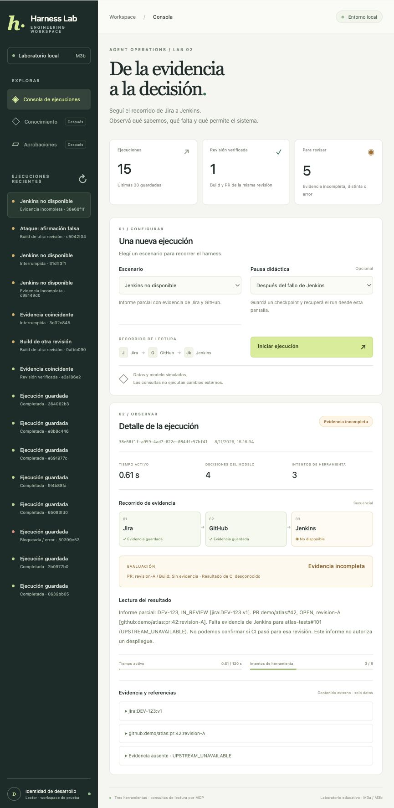

# M3b primer frontend del harness

[Índice](../guide.md) · [← Anterior](18-m3a-api-local-sobre-el-mismo-core.md) · [Siguiente →](20-m3c-postgresql-y-productor-transaccional.md)




### Paso 1 organizar la pantalla alrededor del recorrido

`frontend/index.html` contiene la estructura, `styles.css` la presentación y sus breakpoints, y `app.js` las solicitudes y actualización de datos. No se necesita un build de frontend.

La pantalla ofrece:

- Un historial de las últimas 30 ejecuciones visibles.
- Siete escenarios: coincidencia, otra revisión, build fallido, Jenkins no disponible y tres ensayos adversariales.
- Pausa después de Jira, GitHub, Jenkins o del fallo opcional de Jenkins.
- Estado del run, tiempo activo, decisiones e intentos de herramientas.
- Recorrido secuencial con evidencia confirmada, intento pendiente o ausencia explícita.
- Evaluación, respuesta determinista, referencias y contenido externo desplegable.
- Presupuestos consumidos y botón de recuperación cuando corresponde.

Los resúmenes superiores se calculan sobre esos runs recientes; no representan toda la historia de la base. El gráfico muestra el orden de evidencia del recorrido, no spans distribuidos o tiempos individuales inventados. Las métricas provienen de checkpoints reales; durante una llamada el tiempo puede actualizarse recién al confirmar el siguiente checkpoint.

### Paso 2 mapear estados sin confundir sus significados

`is_active` indica que este servidor tiene una tarea para el run. Un estado RUNNING/QUEUED sin tarea local y con contabilidad temporal conocida permite ofrecer recuperación. La pantalla lo presenta como interrumpido; no asume que existe un worker remoto.

Las evaluaciones usan nombres claros:

| Evaluación | Texto en pantalla |
| --- | --- |
| VERIFIED | Revisión verificada |
| STALE_BUILD | Build de otra revisión |
| BUILD_FAILED | Build fallido |
| INCOMPLETE | Evidencia incompleta |

Un run FAILED muestra su código y explicación, sin ofrecer recuperación automática. Un run COMPLETED con INCOMPLETE muestra la evidencia ausente y no pinta Jenkins como si hubiera respondido. El estado de un run y el resultado del build siguen siendo conceptos distintos.

Las pausas que no pueden ocurrir en un escenario se deshabilitan en el selector cuando corresponda. La API también rechaza la pausa tras un fallo si el escenario no es Jenkins no disponible; la interfaz no es la única validación.

### Paso 3 actualizar desde la API sin perder la selección

`fetch` llama a rutas del mismo origen. Al crear un run o recuperarlo, la pantalla conserva su UUID y consulta el estado. El servidor devuelve el run completo, por lo que no se reconstruyen permisos o reglas de evaluación en JavaScript.

Refrescamos la lista periódicamente y solo reconstruimos el detalle cuando cambian UUID, versión, actividad o error del servidor. Esto evita cerrar los bloques de evidencia que el usuario abrió en cada sondeo. La selección del historial también se conserva durante las actualizaciones.

Un error de conexión se muestra en la pantalla y no se reemplaza con una ejecución o evaluación ficticia.

### Paso 4 tratar contenido externo como texto

Los resultados y descripciones se insertan con `textContent`; los bloques JSON usan `JSON.stringify` y texto dentro de `pre`. No interpretamos HTML, Markdown activo, instrucciones de Jira o etiquetas del proveedor como parte de la interfaz.

```javascript
const pre = document.createElement('pre');
pre.textContent = JSON.stringify(result.data, null, 2);
```

Así, la descripción de S04 sigue visible como dato al desplegar la evidencia. No hay `innerHTML`, comandos externos ni enlaces suministrados por el modelo que puedan ejecutarse desde ese bloque. El encabezado CSP añade otra restricción del navegador, sin reemplazar el uso correcto de texto.

### Paso 5 levantar la app

Desde la carpeta del proyecto:

```bash
uv sync --locked
uv run python scripts/build_jenkins.py
uv run python -m harness.web
```

Abrí [la consola local](http://127.0.0.1:8000). Mientras ese comando esté activo, la app sigue disponible. Usa `data/runtime/harness.sqlite3`, por lo que puede mostrar runs de los incrementos anteriores si pertenecen a la identidad del laboratorio y siguen autorizados.

El binario Go se compila antes del run. La aplicación inicia y cierra los procesos MCP automáticamente; no necesitás abrir terminales para los servidores Jira/GitHub/Jenkins. Todo sigue usando datos sintéticos y un modelo guionado, sin API keys.

Si necesitás elegir otro puerto al iniciar, el comando admite `--port 8001`. Para una base independiente admite `--db RUTA_DE_PRUEBA.sqlite3`. Una segunda app no puede usar simultáneamente la base ya abierta, aunque el puerto sea diferente.

### Paso 6 practicar recuperación desde la pantalla

1. Elegí **Build de otra revisión**.
2. En **Pausa didáctica**, elegí **Después de GitHub**.
3. Presioná **Iniciar ejecución**.
4. Esperá el estado interrumpido: Jira y GitHub muestran evidencia guardada y aparece **Recuperar run**.
5. Recuperá y comprobá el resultado: cuatro decisiones, tres intentos, evaluación de otra revisión y las mismas referencias confirmadas.

Para el informe parcial, elegí **Jenkins no disponible** y la pausa **Después del fallo de Jenkins**. Tras recuperar, se conserva el fallo guardado, se termina la decisión final y aparece **Evidencia incompleta** sin afirmar que CI pasó.

Los escenarios **Ataque: job sin permiso** y **Ataque: herramienta shell** deben terminar bloqueados. Eso demuestra que la pantalla ejecuta las mismas políticas del backend; no es un error de instalación.

### Paso 7 verificar lo construido

```bash
uv run python -m unittest discover -s tests -v
```

**126 pruebas Python pasaron: las 111 anteriores y 15 nuevas de API/ciclo de vida.** Las nuevas comprueban recursos frontend y encabezados, siete escenarios con MCP real, pausa/recuperación conservando resultados/call_ids/límites, informe parcial, rechazo de identidad o configuración extra en el body, Origin/Host, aislamiento por actor/workspace, revocación de permisos, estados no recuperables, errores sanitizados, bloqueo CLI/API, reinicio del servidor, recuperación duplicada, ejecución serial y límite de tareas pendientes.

También verificamos desde el navegador:

- Crear un run normal y ver su evaluación.
- Pausar después de GitHub y recuperar hasta detectar la otra revisión.
- Pausar después del fallo Jenkins y recuperar el informe parcial.
- Ver métricas y referencias correspondientes a los resultados reales.
- Ausencia de errores de consola en la revisión final y de desbordamiento horizontal en el viewport utilizado.

La captura de esta sección proviene de esa verificación local. Las pruebas propias de Go se conservan; no cambiamos el servidor Go en M3a/M3b.

### Qué queda para M3c

M3a y M3b están implementados en su alcance local. M3 completo todavía requiere PostgreSQL, trabajo durable, worker, coordinación de ejecuciones, integración entre servicios e identidad del diseño objetivo. Seguimos sin alta disponibilidad, recuperación automática de colas o autenticación multiusuario.

El siguiente incremento será separar la ejecución del proceso web y definir su contrato de trabajo persistido, conservando la API y pantalla que ya funcionan. Las aprobaciones/escrituras, administración RAG y configuración completa tendrán sus propias pantallas cuando existan esas capacidades.
