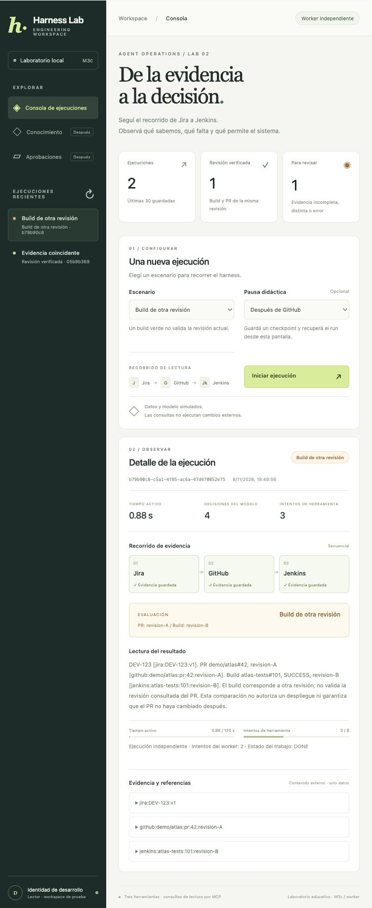

# M3c worker independiente leases y recuperación

[Índice](../guide.md) · [← Anterior](20-m3c-postgresql-y-productor-transaccional.md) · [Siguiente →](22-m3c-api-y-worker-en-docker-compose.md)




### Paso 1 separar admisión de ejecución

La API PostgreSQL ahora admite el run y su job; un proceso `harness.worker` ejecuta el core. El navegador mantiene las mismas rutas HTTP y la misma validación de entrada.

```text
Frontend → API → PostgreSQL: run + job PENDING
                       ↑               ↓
                  checkpoints ← worker independiente → MCP Jira / GitHub / Jenkins
```

La API no crea una tarea de ejecución en memoria en este modo. Si se cierra la pestaña o se reinicia la API, el trabajo confirmado sigue en PostgreSQL y el worker no necesita que la API esté abierta.

Conservamos el modo SQLite local con `--storage sqlite` (predeterminado) y agregamos `--storage postgres`. Los historiales son bases distintas: no copiamos, fusionamos o migramos automáticamente los runs SQLite a PostgreSQL. El ejemplo PostgreSQL usa el puerto web 8001 para poder comparar ambos modos.

### Paso 2 migrar jobs sin borrar los pendientes anteriores

`harness/migrations/002_worker.sql` avanza el schema SQL de 1 a 2. Conserva los runs y jobs existentes y agrega:

| Campo | Función |
| --- | --- |
| `status` | PENDING, RUNNING, PAUSED, DONE, FAILED o CANCELLED. |
| `owner` | Identificador del worker que tiene el reclamo actual. |
| `fencing_token` | Número que aumenta con cada reclamo. |
| `lease_until` | Vencimiento según el reloj PostgreSQL. |
| `attempts` / `max_attempts` | Intentos de procesamiento, separados de llamadas del modelo/tools. |
| `pause_at` | Pausa didáctica que debe respetar el worker. |
| `last_error` | Código sanitizado de error del trabajo. |
| `updated_at` | Última modificación del trabajo. |

Una restricción SQL exige owner y vencimiento para RUNNING, y ambos vacíos para los demás estados. La migración mantiene la protección frente a versiones SQL desconocidas; el schema JSON del run sigue siendo 2. No son la misma versión.

### Paso 3 reclamar trabajo con una transacción corta

`PostgresRunStore.claim_next` busca trabajo PENDING o RUNNING con lease vencido, limitado al actor/workspace de la identidad de desarrollo del worker. Selecciona una fila con:

```sql
FOR UPDATE SKIP LOCKED
```

La misma sentencia actualiza owner, vencimiento, intentos y token, y devuelve el reclamo. No mantenemos abierta esa transacción mientras esperamos al modelo o a MCP.

`SKIP LOCKED` permite que otro consumidor pase a otra fila disponible, un uso de cola descrito en la [documentación de SELECT](https://www.postgresql.org/docs/current/sql-select.html). Dos workers pueden procesar jobs diferentes; no obtienen el mismo reclamo vigente.

El objeto `Claim` identifica trabajo/run, propietario, token, sujeto, pausa e intentos. Su vencimiento no se valida con el reloj del worker: PostgreSQL decide si el lease sigue vigente.

### Paso 4 distinguir lease, heartbeat y fencing

Un **lease** es un reclamo temporal. Por defecto dura 15 segundos. El worker renueva aproximadamente cada tercio del período mediante un **heartbeat** mientras procesa.

Usamos `clock_timestamp()` para comprobar el tiempo actual del servidor y no un reloj del cliente o una fecha congelada al inicio de una transacción. Ver las [funciones de fecha/hora de PostgreSQL](https://www.postgresql.org/docs/current/functions-datetime.html).

Una renovación solo sirve para el mismo owner/token y un lease que todavía está vigente. Un worker no puede resucitar un lease ya vencido. Si otro proceso reclama el job, el token aumenta, incluso si reutiliza el mismo nombre de worker.

**Fencing** significa exigir ese token al confirmar progreso. `store.bind(claim)` produce el store que usa el core de ese intento. Cada actualización exige el trabajo correcto, el actor/workspace, el token/owner actuales y lease vigente. La condición temporal se vuelve a comprobar en la escritura SQL, además del bloqueo de fila.

Un token viejo no puede guardar, renovar o confirmar resultados después de un reclamo nuevo. Si el trabajo desaparece, el store ligado al claim también falla cerrado. Las actualizaciones directas sin claim siguen rechazadas para runs con job.

### Paso 5 ejecutar el mismo core y vigilar el lease

`harness/worker.py` compone el harness existente con el store ligado al claim y llama `resume`. Ese método ya sabe ejecutar QUEUED, recuperar RUNNING y reautorizar resultados/fallos guardados. No implementamos otro loop de agente.

Dos wrappers pequeños comprueban el lease antes de entrar al adaptador del modelo o herramienta. El heartbeat se ejecuta en paralelo con esa espera. Si pierde lease o conexión, el worker cancela la ejecución local y deja de confirmar progreso con ese reclamo.

El core conserva contadores, límites, reservas, perfiles y reglas de evaluación. El job no contiene roles elegidos por el modelo o navegador. Esta implementación usa la identidad sintética confiable configurada en el worker, con actor/workspace explícitos. Todavía no consulta un proveedor empresarial de identidad ni actualiza permisos desde un directorio externo.

Si un error de configuración o autorización ocurre antes de que el core pueda terminar el run, el worker lo marca con un código y cierra el job como FAILED. Un error del proveedor que permite informe parcial conserva las reglas de M2: el informe puede terminar COMPLETED y el job DONE con evaluación INCOMPLETE.

Los intentos del worker son otro presupuesto: permitimos hasta ocho intentos de procesamiento por job. El reclamo siguiente solo cierra el trabajo con WORKER_ATTEMPTS_EXCEEDED, sin consultar al modelo ni herramientas. Por eso el contador de reclamos puede mostrar ese intento final de cierre. No reiniciamos los presupuestos del core al reclamar.

### Paso 6 confirmar resultado y trabajo juntos

Al guardar un run terminal con claim válido, el store actualiza en la misma transacción:

```text
run COMPLETED → job DONE
run FAILED    → job FAILED
run CANCELLED → job CANCELLED
```

La operación libera owner/lease y conserva intentos/token como historial del job. Así no dejamos un resultado terminal confirmado mientras el job sigue pareciendo pendiente por un commit separado.

Para lecturas HTTP de este modo usamos un snapshot SQL conjunto de run y job. Evitamos mezclar un run leído antes de un commit con un job leído después, lo que podría mostrar una combinación imposible de estados en pantalla.

### Paso 7 recuperar una caída sin reiniciar presupuestos

Si el proceso muere abruptamente, no hay un cleanup que libere el lease. El job permanece RUNNING hasta vencer. Otro worker lo reclama con un token mayor y recupera el checkpoint.

- Resultado confirmado: se reutiliza; no repetimos esa consulta.
- Llamada sin resultado confirmado: se conserva `call_id`, se imputa su reserva temporal huérfana y un nuevo intento consume otro cupo.
- Tiempo entre procesos: no se cobra como tiempo activo del core.
- Run terminal: no se vuelve a ejecutar su recorrido.

Probamos ambos casos con un proceso que realmente termina mediante `os._exit(2)`: después de guardar Jira y antes de enviar la consulta a Jenkins. El sucesor conserva evidencias/correlación y los contadores tienen el incremento esperado.

Un cierre ordenado es diferente: la cancelación del core puede confirmar CANCELLED. No lo interpretamos como caída ni reintentamos automáticamente un run cancelado. La ejecución de una lectura que ya llegó a un proveedor puede continuar aunque se cancele nuestra espera.

### Paso 8 mantener la pausa didáctica desde el frontend

Las pausas se guardan en el job. `harness/checkpoints.py` comparte la misma regla entre ejecución SQLite y worker.

Después del commit indicado, el worker detiene ese intento y deja el job PAUSED, sin owner o lease. El run conserva su checkpoint READY, resultados y contadores. Los workers no reclaman PAUSED automáticamente.

**Recuperar run** cambia ese job a PENDING de forma transaccional, conserva intentos y desactiva la pausa ya usada. El worker lo reclama y continúa. Un pedido duplicado sobre PENDING o un lease vigente se rechaza RUN_BUSY, aunque llegue a otra instancia API.

Si una caída ocurre justo después del checkpoint y antes de confirmar PAUSED, se recupera como una caída normal del intento; no prometemos que una pausa de demostración ocurra exactamente en ese intervalo de fallo. Los datos confirmados sí se conservan.

### Paso 9 conectar API y pantalla a la cola

En modo PostgreSQL, `PostgresRunService` solo produce y consulta. No usa `asyncio.create_task` para ejecutar el core. Guardamos run/job/pausa y los límites iniciales en una transacción.

La admisión limita a 16 trabajos PENDING/RUNNING por identidad, serializando esa comprobación entre productores. El cliente no puede enviar lease, owner, token, roles o presupuestos en el body.

La pantalla distingue:

- **Esperando worker:** trabajo durable PENDING, aunque no haya un worker disponible.
- **Worker en curso:** reclamo RUNNING vigente.
- **Esperando recuperación:** el lease venció; un worker puede retomarlo.
- **Interrumpida:** pausa didáctica con recuperación manual disponible.
- **Resultado terminal:** estado/evaluación del run y estado final del job.

También muestra los intentos del worker, distintos de las decisiones del modelo e intentos de herramienta. El badge M3c y «Worker independiente» identifican este modo; no constituyen un chequeo global de salud del worker. La actividad se obtiene del estado persistido y del lease, no de una lista de tareas en la memoria de la API.

La API PostgreSQL no usa el bloqueo de archivo de SQLite. Varios productores coordinan la admisión/reanudación en PostgreSQL; el trabajo lo autorizan los claims. Conservamos el bloqueo de archivo para el modo local SQLite.

### Paso 10 levantar los tres procesos

Primero asegurar PostgreSQL y el binario Go:

```bash
uv run python scripts/postgres.py up
uv run python scripts/build_jenkins.py
```

En una terminal:

```bash
uv run python -m harness.web --storage postgres --port 8001
```

En otra:

```bash
uv run python -m harness.worker
```

Abrí [el frontend con worker](http://127.0.0.1:8001). Elegí **Build de otra revisión**, pausa **Después de GitHub**, iniciá y recuperá. Esperado: STALE_BUILD, cuatro decisiones, tres herramientas y dos intentos del worker, sin repetir Jira/GitHub.

Ya verificamos ese recorrido desde el navegador. El primer job que habíamos dejado PENDING en el incremento anterior también fue consumido y terminó DONE, conservando su UUID original.

El modo anterior sigue disponible con `uv run python -m harness.web` sobre SQLite. En este entorno puede permanecer en 8000 y mostrar otro historial. El frontend PostgreSQL no sustituye ese archivo ni usa sus runs.

Solo PostgreSQL está dentro de Compose por ahora. API/worker son procesos Python separados en el host y MCP sigue siendo stdio local. Contenerizarlos y pasar las conexiones a servicios remotos requiere su configuración e identidad correspondientes.

### Paso 11 practicar recuperación automática tras una caída

Para que el experimento reclame el job esperado, detené primero los workers normales. Admití un trabajo:

```bash
uv run python -m harness.postgres enqueue
```

Ejecutá un consumidor que corte abruptamente después de confirmar el primer resultado:

```bash
uv run python -m harness.worker --once --lease-seconds 2 --crash-at after-result --after-results 1
```

La salida 2 es intencional. Después iniciá un worker normal:

```bash
uv run python -m harness.worker
```

Esperará hasta poder reclamar el lease vencido y continuará sin repetir el primer resultado. No necesitás pulsar recuperar para una caída: los RUNNING vencidos son candidatos automáticos. En cambio, PAUSED espera una decisión explícita del usuario.

El flag de caída está limitado al experimento del operador y no forma parte de la API. No se toma del texto del ticket o del modelo.

### Paso 12 qué garantiza y qué todavía no

Probamos un solo reclamo vigente para el job, checkpoints protegidos por token, progreso terminal atómico y recuperación con presupuestos persistidos. Esto **no garantiza una única llamada remota**: un worker puede perder el lease con una lectura ya en vuelo, y otro puede repetirla al recuperar.

Las integraciones MCP actuales no reciben ni aplican el fencing token. El token protege PostgreSQL y las comprobaciones de despacho del host; existe un intervalo entre comprobar y enviar. Por eso seguimos permitiendo recuperación automática exclusivamente de lecturas. Las escrituras necesitarán las garantías de operación/idempotencia/reconciliación de M4, no solamente un lease.

El heartbeat y cancelación son cooperativos, y el adaptador de base sigue siendo síncrono con timeouts propios. La identidad es de desarrollo. No implementamos autenticación empresarial, supervisión de procesos, alta disponibilidad o una garantía de tiempo real en este incremento.

### Paso 13 pruebas de este incremento

```bash
uv run python -m unittest discover -s tests -v
uv run python -m unittest discover -s integration_tests -v
```

**Pasaron 126 pruebas habituales y 36 pruebas de integración PostgreSQL real.** Las 36 incluyen las 14 del incremento anterior, 15 de worker y 7 de API PostgreSQL:

- Reclamos concurrentes del mismo job y de jobs distintos.
- Lease vencido que no se renueva y token viejo rechazado, incluso reutilizando el mismo nombre de worker.
- Heartbeat durante una espera larga y finalización atómica run/job.
- Pausa/reanudación sin repetir evidencia, límites de admisión e intentos de worker.
- Caídas reales entre procesos, recuperación de lectura pendiente con el mismo `call_id` y cargos conservadores.
- Pérdida de lease durante una decisión: no confirma una cancelación con token viejo ni despacha otra tool.
- Reautorización de resultados, filtrado por actor/workspace y store ligado a un job que desapareció.
- API solo productora, ejecución sin API abierta, dos API sin duplicar reanudación, body sin autoridad de claims y rechazo de acciones prohibidas.

No omitimos la integración si falta PostgreSQL. Cada prueba usa un schema temporal propio y solo elimina ese schema. El servidor Go no cambió y conserva sus pruebas anteriores.

### Qué sigue dentro de la arquitectura objetivo

El recorrido API → PostgreSQL → worker → MCP ya funciona con backends/modelo simulados y puede observarse desde el frontend. Quedan la operación de estos procesos como servicios, conexiones MCP remotas con identidad verificable, observabilidad entre procesos y las acciones aprobadas de M4. No damos por completada la plataforma empresarial por tener una cola local con leases.
