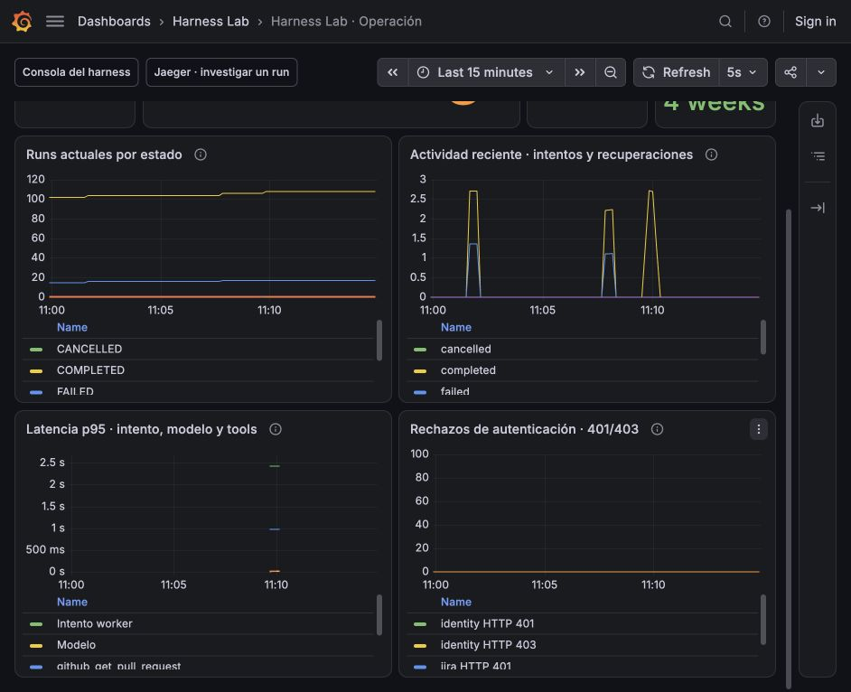

# M3c Prometheus y Grafana

[Índice](../guide.md) · [← Anterior](27-m3c-opentelemetry-y-jaeger.md) · [Siguiente →](29-m3c-alertas-e-incidente-investigable.md)


### Paso 1 qué pregunta responde cada herramienta

Con Jaeger investigamos una ejecución concreta. Ahora agregamos series temporales para observar volumen, estados, latencias y señales operativas del conjunto.

```text
Core / worker / servicios → métricas en memoria → endpoint interno :9100
                                                       ↑ scrape cada 10 s
PostgreSQL → snapshot agregado del API ───────────→ Prometheus → Grafana
Certificado activo → vencimiento numérico ──────────────┘
```

[Prometheus](https://prometheus.io/docs/prometheus/latest/getting_started/) obtiene muestras consultando endpoints periódicamente. Grafana consulta esas series para dibujar paneles. Ninguno concede permisos, reclama jobs o decide si recuperar un run. La cola/checkpoints y la evidencia siguen en PostgreSQL.

En este incremento hay métricas básicas y un dashboard provisionado. No configuramos reglas de alerta, destinatarios o notificaciones. Los colores de los paneles son umbrales visuales.

### Paso 2 dependencias y servicios locales

Agregamos `prometheus-client` de Python con rango compatible `<1` y versión exacta resuelta en `uv.lock`. Compose incorpora `prom/prometheus:v3.16.0` y `grafana/grafana:13.3.0`.

```bash
uv sync --locked
uv run python scripts/stack.py up
```

| Vista | Dirección |
| --- | --- |
| Consola del harness | http://127.0.0.1:8002 |
| Dashboard Grafana | http://127.0.0.1:3003/d/harness-overview |
| Consultas/targets Prometheus | http://127.0.0.1:9090 |
| Jaeger | http://127.0.0.1:16686 |

Cada servicio de la app expone métricas en el puerto 9100 **solo en la red de Compose**. No publicamos esos cuatro puertos en el host. El endpoint es de lectura, con un registro de métricas propio; no exportamos automáticamente todos los datos del proceso, del host o de HTTP.

Prometheus lee `observability/prometheus.yml`: cuatro targets, identificados con `role=api|worker|identity|jira`. Scrapea cada 10 segundos con timeout de seis. Los listeners de métricas trabajan en threads separados; el snapshot SQL del API no se ejecuta en su event loop. La configuración `HARNESS_METRICS=1` activa listeners en Compose; los comandos/pruebas locales habituales no abren ese puerto por defecto.

### Paso 3 distinguir Counter, Gauge e Histogram

| Tipo | Uso aquí | Comportamiento |
| --- | --- | --- |
| Counter | Intentos, recuperaciones, llamadas y rechazos. | Sube mientras vive el proceso; puede reiniciarse al recrearlo. |
| Gauge | Estado de jobs/runs, leases vencidos, vencimiento TLS. | Representa el valor observado en el scrape actual. |
| Histogram | Duración de intento, modelo y herramienta. | Cuenta observaciones en buckets para estimar distribuciones. |

Las métricas de proceso no son una auditoría durable. Una muerte antes de observar/exportar una muestra puede perder actividad. PromQL `rate`/`increase` manejan resets observables, pero no reconstruyen todos los eventos de un proceso que murió. `increase` puede producir valores fraccionarios por extrapolación.

Por eso no contamos un run único con un Counter del worker: una pausa y recuperación son **dos intentos** del mismo run. La cantidad actual de runs completados se obtiene de PostgreSQL con un Gauge.

### Paso 4 instrumentar llamadas sin mover controles

`harness/metrics.py` centraliza registro, etiquetas y observaciones protegidas. El cliente Python actualiza valores locales; no hace una petición a Prometheus al invocar un modelo o una tool.

| Métrica | Qué significa |
| --- | --- |
| `harness_attempts_total{outcome}` | Intentos terminados como completed/failed/paused/cancelled/lease_lost. |
| `harness_recovery_attempts_total` | Claims cuyo `attempts > 1`; incluye pausa/resume y recuperación tras interrupción. |
| `harness_attempt_duration_seconds` | Tiempo del intento observado en el worker. |
| `harness_operations_total{operation,tool,outcome}` | Llamadas reales al puerto de modelo/tool, con éxito/error/timeout/cancelación. |
| `harness_operation_duration_seconds` | Duración de esas llamadas. |
| `harness_auth_rejections_total{endpoint,status}` | Respuestas 401/403 del emisor o endpoint MCP. |

La operación del modelo es todavía guionada: medimos el puerto y no inventamos tokens de un proveedor real. Una decisión del modelo que luego propone un recurso prohibido puede ser una llamada exitosa al modelo y terminar en un run fallido por política: son resultados de capas distintas.

El contexto de observación está alrededor de los awaits existentes; conserva `wait_for`, reservas, checkpoints, normalización y controles de política. Un fallo del objeto de métricas no cambia el valor devuelto ni sustituye la excepción de negocio. No hay reintentos de tools por razones de métricas.

La duración del intento no incluye su tiempo en cola. Las duraciones de modelo/tools y del intento tienen histogramas separados, con buckets desde milisegundos hasta el presupuesto máximo del laboratorio.

### Paso 5 leer estado durable sin modificarlo

`PostgresRunStore.operational_snapshot(identity)` hace una única consulta agregada, bajo el workspace/actor confiable del laboratorio, para observar runs, jobs y leases vencidos. No carga ni exporta descripciones, argumentos, respuestas, identidades o recursos.

| Métrica | Fuente |
| --- | --- |
| `harness_runs_state{status}` | Estado actual de runs persistidos. |
| `harness_jobs_state{status}` | Estado actual de jobs persistidos. |
| `harness_jobs_expired_lease` | Subconjunto RUNNING cuyo lease venció según el reloj PostgreSQL. |
| `harness_state_collection_success` | 1 si el snapshot completo se pudo leer/validar, 0 si falló. |

Un run pausado conserva `RUNNING` en su contrato; su job pasa a `PAUSED`. Los dos paneles muestran esas capas por separado. Un lease vencido es un subconjunto de RUNNING, no otro job que se deba sumar al total.

La consulta es de observación: no bloquea jobs con `FOR UPDATE`, no renueva leases ni incrementa fencing. Si falla, omitimos los gauges de estado y publicamos fallo de recolección. Un problema de base **no se convierte en cero pendientes**. Si la lectura tarda más que el timeout de scrape, Prometheus marca el target como `up=0`.

El recolector del API no amplía permisos de escritura ni afecta al claim. Las pruebas comprueban que observar un lease vencido no cambia su fencing y que el worker puede recuperarlo con las reglas anteriores.

### Paso 6 observar los certificados que realmente están activos

Los servicios TLS exponen `harness_certificate_not_after_seconds`, el timestamp de vencimiento del certificado del snapshot activo. Se lee del objeto de recarga en vivo, no de una copia histórica del host. Al renovar, el mismo conjunto de etiquetas recibe el vencimiento nuevo.

Grafana calcula:

```promql
harness_certificate_not_after_seconds - time()
```

El panel usa duración legible y umbrales de uno/siete días. También se exporta `harness_certificate_collection_success` para distinguir ausencia/error de lectura de un certificado válido.

Un rechazo de autenticación se cuenta por status HTTP. Una denegación de recurso que el servidor MCP devuelve como resultado de herramienta dentro de HTTP 200 no es un 401/403; se investiga mediante los spans/códigos del run. No copiamos el token, mensaje o header a una etiqueta.

### Paso 7 etiquetas acotadas y privacidad

Las dimensiones de la app son enumeraciones: `operation`, herramienta conocida, outcome, endpoint y status. Prometheus añade su target estable (`instance`, `job`, `role`); el histograma añade `le` para el límite del bucket.

No usamos `run_id`, `call_id`, trace ID, usuario, workspace, proyecto, repositorio, job de Jenkins, URL completa, texto libre, JWT o secreto como etiquetas. Una etiqueta distinta crea otra serie: incluir identificadores por ejecución haría crecer la cardinalidad sin límite y mezclaría observabilidad con datos privados.

Para investigar un run específico seguimos usando su UUID en la consola/Jaeger. Las métricas responden por el conjunto. Los endpoints internos exportan un registro propio, sin activar colectores automáticos del equipo. Los materiales privados actuales/históricos siguen fuera de los archivos visibles para Git.

### Paso 8 provisionar un dashboard pequeño y reproducible

Los archivos viven en `observability/grafana/`:

- Un datasource Prometheus con UID fijo `harness-prometheus`.
- Un proveedor de dashboard de archivo, con edición desde UI desactivada.
- `dashboards/harness.json`, ocho paneles y enlaces a consola/Jaeger.

Usamos [provisioning de Grafana](https://grafana.com/docs/grafana/latest/administration/provisioning/) para que levantar el repositorio deje el dashboard listo. Los cambios se hacen en JSON versionable, no dependen de clics manuales guardados en otra computadora.

Tras editar el JSON, subí su `version` y aplicalo explícitamente al monitor:

```bash
uv run python scripts/stack.py reload-dashboard
```

Este comando reinicia solo Grafana y espera su salud; no toca API, worker, Prometheus ni PostgreSQL. Las pruebas comparan las expresiones del archivo con las que Grafana sirve por su API v1, además de ejecutar las consultas. Así verificamos la definición aplicada y no solo un JSON correcto en disco.

El acceso local es [anónimo con rol Viewer](https://grafana.com/docs/grafana/latest/setup-grafana/configure-access/configure-authentication/anonymous-auth/), vinculado únicamente a loopback. Desactivamos creación del administrador inicial, Basic auth, login form y signup: no introducimos credenciales personales ni la contraseña predeterminada de un administrador. La prueba comprueba que el visor puede consultar el datasource y recibe rechazo al intentar escribir el dashboard.

Es un visor para el laboratorio local. Compartir Grafana remotamente requerirá autenticación/autorización y configuración de red propias; no se publica a Internet aquí.



### Paso 9 leer los ocho paneles

1. **Servicios scrapeables:** esperado cuatro. `up` confirma lectura del exporter; no prueba éxito de un run ni salud completa de todos sus proveedores.
2. **Cola durable y leases:** pendientes, pausados, RUNNING y leases vencidos.
3. **Snapshot PostgreSQL válido:** diferencia estado fiable de error de recolección.
4. **Vigencia TLS activa:** emisor y Jira, usando el material que sirven hoy.
5. **Runs actuales por estado:** conteos persistidos, incluidos históricos del laboratorio.
6. **Actividad reciente:** incrementos observados de intentos y recuperaciones por ventana.
7. **Latencia p95:** intento completo, modelo y cada tool.
8. **Rechazos de autenticación:** HTTP 401/403 por rol de servicio.

El exporter también expone `harness_process_start_time_seconds`, un valor numérico sin IDs. Las consultas p95 requieren que el proceso lleve activo más que la ventana de `rate`; así excluyen una transición de reinicio que podría mezclar tasas de buckets y provocar una advertencia de monotonicidad. La primera ventana tras arrancar aparece sin muestras.

`p95` es una estimación de histograma: aproximadamente el valor bajo el que cae el 95% de observaciones de la ventana, con precisión limitada por los buckets. No es la duración exacta del último run. Requiere una ventana estable después del arranque, tráfico y al menos dos scrapes; `Sin muestras`/NaN al inicio no es latencia cero.

Grafana refresca cada cinco segundos; Prometheus scrapea cada diez. Podés necesitar esperar dos o tres scrapes para ver cambios o distribuciones después de generar tráfico. El rango inicial es los últimos quince minutos.

### Paso 10 practicar pausa, fallo y recuperación

1. Abrí http://127.0.0.1:3003/d/harness-overview.
2. En la consola 8002, ejecutá `Evidencia coincidente`, con pausa tras Jira.
3. Observá `PAUSED` en jobs y el intento pausado; recuperá desde la consola.
4. Completá con cuatro decisiones y tres herramientas. El Gauge de runs cuenta una finalización; los Counters registran dos intentos y uno de recuperación.
5. Ejecutá `Ataque: job sin permiso` para ver un intento fallido; investigá el `FORBIDDEN` de política en Jaeger.
6. Revisá p95 tras varias ejecuciones; comparalo con la duración concreta de un span para entender distribución frente a ejemplo individual.

La recuperación mantiene la evidencia Jira confirmada sin otra invocación a esa herramienta. La recolección no afecta reservas, tiempo activo, límites, CAS, leases, heartbeat o fencing. Los histogramas no añaden llamadas al modelo.

### Paso 11 persistencia y monitores apagados

Prometheus usa volumen propio y retención de siete días. Grafana conserva su base/configuración en otro volumen y reprovisiona el JSON del repositorio. `stack.py down` conserva ambos volúmenes, igual que PostgreSQL. No usamos `down -v` como parte del ejercicio.

Los contadores en RAM pueden volver a cero cuando reinicia un proceso; las series de Prometheus y los estados PostgreSQL tienen otra persistencia. Jaeger mantiene la decisión previa de memoria transitoria: reiniciarlo borra trazas sin borrar las métricas históricas de Prometheus.

Los servicios de la app no dependen de Prometheus/Grafana para ejecutar. En la prueba real apagamos ambos monitores durante un run pausado, recuperamos su evidencia y los levantamos después. El run completó con el mismo presupuesto y estado. Un monitor caído deja de observar, no concede permiso para repetir una tool ni bloquea un commit.

### Paso 12 pruebas y siguiente incremento

```bash
uv run python -m unittest discover -s tests -v
uv run python -m unittest discover -s integration_tests -v
uv run python -m unittest discover -s container_tests -v
```

**Pasaron 179 pruebas del laboratorio, 43 PostgreSQL y 15 de Compose.** Las nuevas cubren etiquetas/redacción, histogramas/contadores, fallos del objeto de métricas, lectura fallida de estado, scope de snapshots, lease vencido sin mutación, recuperación sin duplicar Jira, queries PromQL reales, proxy Grafana, permisos Viewer, certificados activos y continuidad con monitores apagados.

Las suites de Compose reinician servicios, crean runs sintéticos y algunas rotan claves; ejecutarlas sin otro worker que consuma la misma cola y respetando la ventana de solapamiento antes de repetir rotación. Las comprobaciones esperan la preparación real de Prometheus/Grafana y sus scrapes, no interpretan una conexión de arranque cerrada como un fallo del core.

El siguiente incremento puede definir alertas y practicar un incidente: detectar un síntoma en métricas, localizar el run afectado y analizar su traza en Jaeger. En este paso dejamos las mediciones y la vista operativa listas, sin configurar notificaciones externas.
