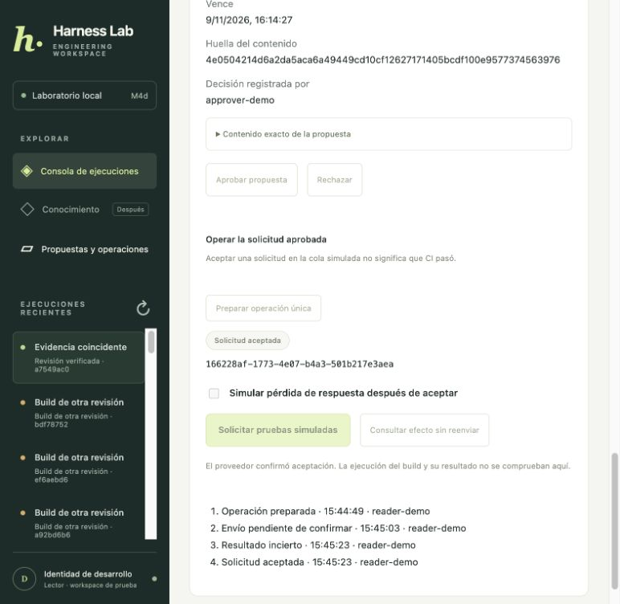

# M4d propuestas y operaciones desde API y frontend local

[Índice](../guide.md) · [← Anterior](33-m4c-despacho-y-consulta-del-efecto-por-mcp.md) · [Siguiente →](35-m4e-resolucion-manual-de-unknown-con-evidencia-del-proveedor.md)


### Paso 1 habilitar una demostración explícita

El recorrido M4 ahora tiene pantalla. No lo habilitamos silenciosamente en cualquier API: se activa con `--approvals-demo`, exige PostgreSQL, la identidad de desarrollo conocida y un bind local `127.0.0.1`.

Con la app Compose y su worker activos, abrí otra terminal desde el proyecto:

```bash
uv run python -m harness.web --storage postgres --approvals-demo --port 8003
```

Abrí http://127.0.0.1:8003. El puerto 8002 sigue siendo la consola Compose anterior. El nuevo proceso comparte PostgreSQL y el worker existente: no levantes un segundo worker del host para este ejercicio. Si todavía no tenés la app preparada, ejecutá primero `uv run python scripts/stack.py up`.

Elegimos el host en este incremento porque comparte el mismo archivo persistente del proveedor de escritura con la CLI. No usamos el runtime temporal del contenedor para guardar efectos, ni creamos otra SQLite vacía que impida encontrar solicitudes históricas. Containerizar ese proveedor requiere definir su almacenamiento/transporte persistente antes de trasladarlo.

Sin la opción, las rutas M4 no se registran y la pantalla se oculta. El modo SQLite local continúa siendo de lectura. Esta demostración no agrega autenticación real ni habilita M4 para identidades personalizadas por sumarles roles automáticamente.

### Paso 2 entender quién actúa

`harness/development.py` reúne los fixtures que antes estaban en la CLI. El servidor define el operador `reader-demo` con capacidades de operador y el aprobador `approver-demo`. Los comandos anteriores importan esas mismas identidades.

Los cuerpos HTTP no aceptan actor, roles, workspace, URL de servidor, argumentos de Jenkins ni rutas de bases. Las rutas de propuesta usan el operador; la decisión usa el aprobador fijo de prueba. Alterar un JSON no cambia esa asignación.

Esto permite practicar el flujo con una sola persona, no demostrar separación real entre dos usuarios autenticados. La pantalla lo dice explícitamente. La identidad efectiva y roles de producción deberán venir de autenticación y asignaciones del servidor, no de un selector de navegador. El modo local no se debe publicar mediante un proxy/túnel.

### Paso 3 reutilizar el dominio detrás de las rutas

`harness/approval_web.py` conecta los servicios existentes; no implementa otro ledger ni llama Jenkins sin pasar por `Operations`.

| Ruta | Función |
| --- | --- |
| `GET /api/runs/{id}/proposals` | Consultar hasta veinte propuestas accesibles de una lectura. |
| `POST /api/runs/{id}/proposals` | Crear o recuperar una propuesta con key estable. |
| `GET /api/proposals/{id}` | Consultar propuesta y operación asociada. |
| `POST /api/proposals/{id}/decision` | Decidir sobre hash y versión exactos con el aprobador de prueba. |
| `POST /api/proposals/{id}/operation` | Consumir aprobación y preparar operación única. |
| `GET /api/operations/{id}` | Consultar estado y eventos persistidos. |
| `POST /api/operations/{id}/dispatch` | Enviar por MCP o activar el punto de fallo didáctico after-send. |
| `POST /api/operations/{id}/reconcile` | Buscar el efecto con el mismo ID/hash, sin reenviar. |

Las rutas síncronas trabajan en el thread pool de FastAPI; no bloquean el event loop con SQL o con el cliente MCP síncrono. La API sigue siendo productora de jobs para las lecturas: el worker hace esas consultas. En este incremento las operaciones aprobadas sí se ejecutan durante la petición HTTP acotada; todavía no hay un worker de escrituras.

Conservamos el control de origen, cabecera de la consola, TrustedHost, CSP y errores sanitizados de la API. Esas barreras de navegador no sustituyen autenticación. Los stores siguen verificando propiedad, workspace, roles y recursos; un UUID no otorga acceso.

### Paso 4 crear evidencia y una propuesta

1. En 8003, ejecutá «Evidencia coincidente» o «Build de otra revisión» sin pausa.
2. Esperá a que termine la lectura con evidencia guardada.
3. Abrí «Propuestas y operaciones» en la navegación, o bajá a la sección 03.
4. Pulsá «Crear o recuperar propuesta».

La pantalla muestra job, repositorio, revisión, vencimiento, huella del contenido y actor de decisión. Podés desplegar el JSON exacto que recibirá la aprobación. El texto externo se renderiza con `textContent`, sin interpretarlo como HTML.

La UI conserva una key por run en `localStorage` antes de enviar. Si se pierde la respuesta, el reintento puede recuperar el mismo recurso. Además consulta propuestas existentes desde PostgreSQL y deshabilita crear otra cuando ya hay alguna para ese run: limpiar el almacenamiento del navegador no debe convertirse automáticamente en otra intención.

Este primer frontend trabaja una intención por lectura; para repetir el ejercicio, creá otra lectura. La API conserva su contrato de key por intención y puede consultar las propuestas previas. El historial visual de lecturas sigue limitado a las últimas treinta y el selector muestra hasta veinte propuestas por lectura.

### Paso 5 revisar y decidir explícitamente

En «Revisar como aprobador de prueba», comprobá recurso, revisión, fuentes del payload y vencimiento. Pulsá «Aprobar propuesta» o «Rechazar».

La UI envía la huella y versión que mostró. No recalcula argumentos desde el texto del modelo ni aprueba por el solo hecho de abrir la pantalla. El servidor usa la identidad fija del aprobador; el store conserva las guardas de hash, versión, expiración y separación de actores.

Después de la decisión se deshabilitan ambos botones. Una versión obsoleta produce conflicto y obliga a consultar el estado. Rechazar es terminal para esa propuesta; no se cambia después a APPROVED desde la UI.

### Paso 6 preparar y despachar por separado

Solo una aprobación vigente habilita «Preparar operación única». Después aparece el operation ID y el evento PREPARED. «Solicitar pruebas simuladas» llama al ejecutor del ledger, que conserva todos los controles de M4b/M4c antes de usar MCP.

La pantalla distingue estos actos porque aprobar no es enviar. No hay despacho automático al recibir la aprobación ni al refrescar la página. Cada operación tiene el mismo ID estable y la restricción de consumo único sigue en PostgreSQL.

El estado «Solicitud aceptada» confirma la referencia de cola del proveedor sintético. No significa que un build real corrió ni que CI pasó. La UI muestra esa diferencia junto al resultado.

### Paso 7 practicar recuperación sin terminal

Para una operación PREPARED nueva, marcá «Simular pérdida de respuesta después de aceptar» y después solicitá las pruebas simuladas.

El servidor usa el mismo punto de fallo `after-send` del ejecutor: el proveedor confirmó el efecto, pero se omite la confirmación del ledger. La API captura esa interrupción didáctica y sigue disponible para consultar. No mata el proceso del servidor ni modifica el simulador para fingir éxito.

La UI muestra «Envío pendiente de confirmar» y deshabilita otro envío. Esperá aproximadamente once segundos desde el envío y pulsá «Consultar efecto sin reenviar». Si consultás antes, OPERATION_BUSY indica que el lease todavía está activo.

La consulta conserva el recorrido DISPATCHING → UNKNOWN → SUCCEEDED y muestra los eventos con hora y actor. Si no hay prueba del efecto, permanece UNKNOWN y no se habilita reenviar. El frontend no ofrece el punto `before-send`, que dejaría incertidumbre sin resolución automática; ese valor se rechaza también en el schema HTTP.

Probamos este flujo completo mediante clics en el navegador. La comprobación independiente encontró exactamente una solicitud para el operation ID, y la lectura original siguió con cuatro decisiones y tres herramientas.



### Paso 8 recuperar la vista después de perder una respuesta

«Actualizar estado» y el refresco periódico hacen consultas, nunca aprobaciones ni despachos. Si una mutación devuelve error o se pierde la conexión, la pantalla pide consultar lo persistido en vez de crear otro UUID.

Tras recargar, elegí otra vez la lectura en el historial. Las propuestas y eventos vienen de PostgreSQL; el recibo vive en la SQLite persistente del proveedor. No dependen de la memoria de JavaScript ni del proceso API. Los botones se habilitan según el estado consultado, y el backend vuelve a comprobarlo al ejecutar: deshabilitar un botón no es enforcement.

La key del navegador no es una credencial; perderla no borra la propuesta ni autoriza otra operación. Tampoco elimina UNKNOWN. Para operaciones históricas fuera del historial limitado, las rutas por ID y la CLI siguen disponibles bajo sus controles.

### Paso 9 validar API y compatibilidad

```bash
uv run python -m unittest discover -s integration_tests -p test_approval_web.py -v
uv run python -m unittest discover -s integration_tests -v
uv run python -m unittest discover -s tests -v
uv run python scripts/evaluate.py
```

Las cinco pruebas nuevas usan schemas PostgreSQL y archivos de proveedor temporales. Cubren modo desactivado, configuración no permitida, flujo completo/reintento/reapertura, mismo efecto, rechazo de roles/actor/workspace/argumentos en el cuerpo, origen cruzado, hash incorrecto, propuesta de otro operador sin mutación, preparación sin aprobar y recuperación del punto de fallo por HTTP.

La captura del frontend contiene únicamente fixtures del laboratorio. Los reportes de verificación y bases locales permanecen en `data/runtime/`, ignorados por Git. No fue necesario modificar el core, los workers, las tablas de lectura ni la implementación de consumo/despacho/reconciliación del ledger.

### Paso 10 límites del incremento

El nuevo modo corre localmente en 8003 y comparte el proveedor persistente de la CLI. No habilitamos estas rutas en el contenedor 8002 ni agregamos un segundo worker. Para detenerlo, usá Ctrl-C en su terminal; PostgreSQL, la app Compose y el estado persistido continúan.

Siguen pendientes autenticación de usuarios reales, traslado del despacho a un worker de escrituras, almacenamiento/transporte del proveedor al containerizar, resolución manual de UNKNOWN y ampliación de métricas/trazas/evals de escritura. M4 avanzó hasta un flujo visual verificable; estos límites siguen visibles en la matriz de cierre.

Validación M4d: **196 pruebas locales, 76 PostgreSQL y 9/9 evaluaciones de lectura aprobadas**. Las cinco pruebas nuevas del API incluyen la comprobación de visibilidad antes de decidir sobre una propuesta ajena. Las esperas de lease de integración consultan ahora `clock_timestamp()` en PostgreSQL, evitando asumir sincronía exacta entre host y VM; no cambia el lease de diez segundos de la aplicación. En navegador se completó propuesta/aprobación/consumo, fallo after-send y consulta sin reenvío; el proveedor conservó una solicitud y la lectura cuatro decisiones/tres tools. Tras reiniciar la API se conservaron el éxito y cuatro eventos. No quedaron operaciones de prueba inciertas.
