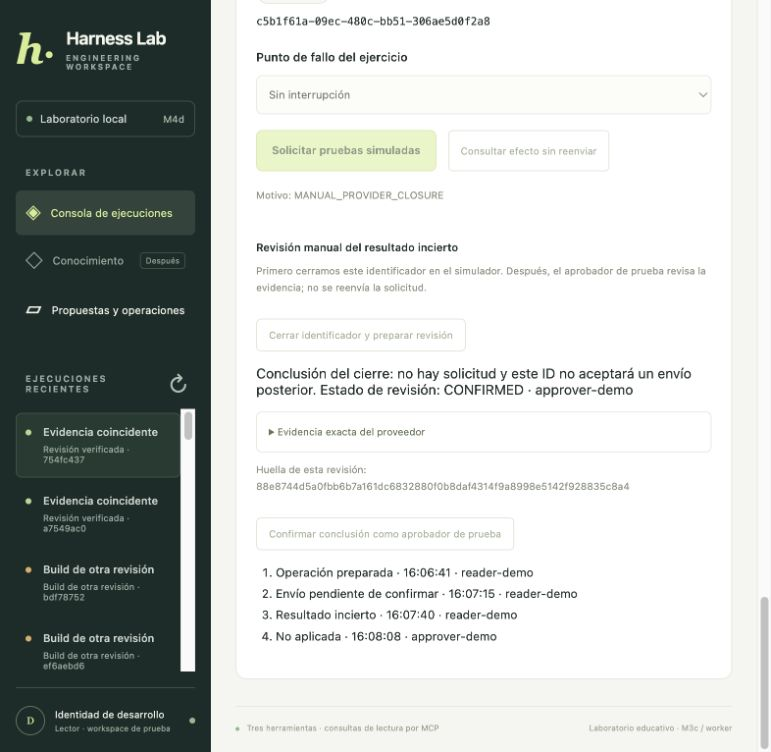

# M4e resolución manual de UNKNOWN con evidencia del proveedor

[Índice](../guide.md) · [← Anterior](34-m4d-propuestas-y-operaciones-desde-api-y-frontend-local.md) · [Siguiente →](36-m4f-worker-independiente-de-escrituras.md)


### Paso 1 no confundir ausencia con prueba de ausencia

Hasta M4d, una búsqueda que no encontraba solicitud dejaba UNKNOWN y bloqueaba otras escrituras al recurso. Seguimos conservando esa regla. No agregamos un botón para declarar «no ocurrió» por intuición ni para crear otro UUID y reenviar.

Ahora el simulador tiene una capacidad adicional: **cerrar permanentemente un operation ID**. En una transacción propia obtiene el recibo existente o registra una marca de cierre sin recibo. Esa marca impide aceptar posteriormente una solicitud nueva con ese ID.

Esto distingue dos hechos:

- `lookup → null`: por sí solo mantiene UNKNOWN.
- `close_request → cerrado sin recibo`: evidencia autoritativa de que este simulador no tiene el efecto y no lo aceptará tarde con ese ID.

Un proveedor real debe ofrecer una garantía equivalente para usar este camino. No asumimos que Jenkins real permita cerrar IDs ni que una búsqueda vacía en su API sea concluyente.

### Paso 2 agregar la capacidad de cierre por MCP

El servidor `jenkins-write-fixture` pasa a versión 2 y expone una cuarta herramienta, `jenkins_close_request`. Recibe solamente operation ID y hash; la identidad y el archivo siguen configurados por el host.

El resultado incluye esos mismos identificadores, `closed: true`, recibo o `null`, hora de cierre y un ID de evidencia. Cliente y servicio verifican estructura, binding y tipos. La herramienta no se registra para el modelo.

El cierre se guarda en `closures`, en la misma SQLite que acepta las solicitudes, con `BEGIN IMMEDIATE`. Así se serializa con una solicitud concurrente: o la solicitud quedó aceptada y el cierre devuelve su recibo, o el cierre ganó y una solicitud tardía recibe OPERATION_CLOSED. No hay una ventana entre consultar y bloquear que permita emitir un certificado vacío y luego aceptar el efecto.

El ID de evidencia es un hash del registro del proveedor. Vincula el contenido, pero no es una firma de un tercero. En este laboratorio confiamos en el servidor stdio y su historial persistente. La confirmación humana no convierte evidencia falsa o un proveedor sin garantías en autoridad.

### Paso 3 guardar una revisión sin resolver todavía el ledger

`harness/resolutions.py` toma únicamente una operación UNKNOWN accesible al operador actual:

1. Lee y conserva la versión exacta del ledger.
2. Solicita el cierre por MCP, fuera de la transacción de creación de la revisión.
3. Valida la respuesta del proveedor.
4. Vuelve a comprobar estado/versión y guarda una revisión inmutable en PostgreSQL.

La operación **sigue UNKNOWN** y el recurso continúa bloqueado mientras la revisión está PENDING_REVIEW. El cierre del proveedor no equivale a una decisión humana del ledger.

La revisión liga operation ID/versión, workspace, solicitante, hash de la propuesta original, proveedor, evidencia y conclusión derivada. No acepta un JSON del cliente afirmando que el efecto no ocurrió. Solo permite una revisión persistida por operación; repetir la solicitud devuelve la misma.

Si se pierde la respuesta después de cerrar en el proveedor pero antes de guardar la revisión, se puede repetir: el proveedor devuelve el mismo cierre durable. No se vuelve a enviar una solicitud de pruebas.

### Paso 4 exigir otro actor y la huella exacta

El aprobador de prueba revisa la evidencia y confirma su hash/versión exactos. El servicio comprueba identidad vigente del directorio, rol, recursos y workspace; impide que el solicitante confirme su propia revisión.

Antes de confirmar vuelve a obtener el mismo cierre y exige que coincida. En una transacción PostgreSQL:

- Cambia la revisión de PENDING_REVIEW v0 a CONFIRMED v1 y guarda quién/cuándo.
- Cambia el ledger usando su versión observada y agrega el evento del aprobador.
- Conserva propuesta original, aprobación consumida y eventos anteriores.

Con recibo, concluye SUCCEEDED; con cierre sin recibo, concluye NOT_APPLIED. Una conclusión manual no crea otra operación, no extiende la aprobación y no vuelve a llamar `request`.

La migración `003_resolutions.sql` sube `proposal_schema_version` a 3. Protege el payload de revisión y permite UNKNOWN → NOT_APPLIED solamente si existe una revisión confirmada para esa misma versión del ledger. Las versiones de las tablas de runs/workers no cambian; que ambas tablas de migraciones usen el número 3 no las convierte en una misma migración.

### Paso 5 respetar carreras y respuestas perdidas

Si la reconciliación automática encontró antes el efecto y resolvió el ledger, la revisión pendiente queda efectiva STALE. Confirmarla devuelve conflicto: no sobrescribimos una conclusión más reciente con evidencia de otra versión.

Repetir una confirmación ya registrada con el mismo aprobador, hash y versión original devuelve lo persistido, sin otro evento. Otro actor, hash o versión no puede reclamar ese acto. Una prueba concurrente verifica una sola transición.

Si falta el proveedor, cambia el cierre o la evidencia es inválida, no se confirma. El recurso sigue protegido. El servicio no ofrece un override libre para suplir un contrato de proveedor que no existe.

### Paso 6 practicar desde la pantalla

La API local sigue en http://127.0.0.1:8003, activada mediante:

```bash
uv run python -m harness.web --storage postgres --approvals-demo --port 8003
```

Usá una lectura/propuesta/operación nueva. Después de aprobar y preparar:

1. En «Punto de fallo del ejercicio», elegí «Antes del envío (practicar resolución)».
2. Solicitá las pruebas simuladas: queda DISPATCHING sin enviar.
3. Esperá aproximadamente once segundos y pulsá «Consultar efecto sin reenviar».
4. La búsqueda vacía deja «Resultado incierto»; todavía no se permite otro envío.
5. Pulsá «Cerrar identificador y preparar revisión». Esto cambia el proveedor: bloquea permanentemente ese ID.
6. Revisá conclusión, evidencia exacta y huella. La operación sigue incierta.
7. Pulsá «Confirmar conclusión como aprobador de prueba».
8. El ledger muestra «No aplicada» y el nuevo evento identifica al aprobador.

M4e habilita y completa el ejercicio before-send que M4d dejaba fuera de la pantalla. `after-send` continúa recuperándose automáticamente mediante consulta; no necesita revisión manual si se encuentra el recibo.

La misma persona puede operar ambos fixtures locales; seguimos sin autenticación de dos personas reales. Si no estás de acuerdo con la evidencia, no confirmes: la operación permanece protegida. No implementamos reapertura/edición de una revisión ni una justificación libre que cambie la conclusión.



### Paso 7 usar la CLI o el API

Para una operación UNKNOWN:

```bash
uv run python scripts/operations.py prepare-resolution OPERATION_ID
uv run python scripts/operations.py resolution OPERATION_ID
uv run python scripts/operations.py confirm-resolution OPERATION_ID --hash RESOLUTION_HASH --version 0
uv run python scripts/operations.py show OPERATION_ID
```

`RESOLUTION_HASH` es la huella de la revisión, no la de la aprobación original. Estos comandos usan MCP por defecto y conservan la alternativa `--transport direct` para comparar el simulador en proceso.

Las rutas nuevas, disponibles solo en el modo de demostración, son:

| Ruta | Resultado |
| --- | --- |
| `GET /api/operations/{id}/resolution` | Revisión guardada o `null` para una operación accesible. |
| `POST /api/operations/{id}/resolution` | Cierra el ID y prepara la revisión. |
| `POST /api/operations/{id}/resolution/confirm` | Confirma el hash/versión con el aprobador fijo del servidor. |

No se acepta `conclusion`, recibo, actor ni roles aportados por HTTP. El refresco de la pantalla solo lee; no cierra IDs ni confirma revisiones por sí mismo.

### Paso 8 no reutilizar la autorización consumida

NOT_APPLIED libera el bloqueo de esa operación para el recurso, pero no habilita su botón de envío. Repetir `dispatch` sobre el ID viejo devuelve NOT_APPLIED; una llamada tardía al proveedor con ese ID también es rechazada, aunque lleve una fecha futura.

Para otra solicitud hace falta **otra intención y otra aprobación**, con evidencia vigente y nuevo operation ID. No automatizamos ese paso al resolver. Si otra operación del mismo recurso sigue UNKNOWN, su bloqueo permanece.

El código del core de lectura y de `Operations` no cambió. La nueva transición usa el mismo control de versión y evento transaccional. Deadline, tiempo activo, presupuestos, autorización y recuperación de los runs anteriores siguen intactos.

### Paso 9 conservar el historial del proveedor

El simulador agrega una identidad de almacén en SQLite y un archivo privado adyacente `*.sqlite3.identity`. Al actualizar una base existente conserva sus solicitudes/cierres y registra esa identidad; al inicializar una instalación nueva crea ambos.

Si se borra la SQLite y queda la marca, o se reemplaza por una base con otra identidad, el proveedor falla cerrado. No puede recrear silenciosamente un almacén vacío y usarlo como evidencia de ausencia. La interfaz MCP puede reportar la indisponibilidad de ese arranque; UNKNOWN no se resuelve por ese error.

Conservá base y marca junto al historial del ledger. Perder o manipular ambos, restaurar copias incoherentes o comprometer al administrador/proveedor queda fuera de esta garantía local: no reconstruimos hechos remotos perdidos a partir de un archivo nuevo. La marca es una comprobación de continuidad, no una credencial ni una copia de seguridad.

### Paso 10 pruebas y resultado

```bash
uv run python -m unittest discover -s integration_tests -p test_resolutions.py -v
uv run python -m unittest discover -s integration_tests -p test_approval_web.py -v
uv run python -m unittest discover -s tests -v
uv run python -m unittest discover -s integration_tests -v
uv run python scripts/evaluate.py
```

Los casos nuevos verifican cierre estable, envío tardío rechazado, separación de actores, hash/versión, evidencia cambiada, bloqueo SQL sin revisión confirmada, carreras, reconciliación automática que gana, resultado aceptado revisado sin duplicarlo, MCP real y el recorrido HTTP completo sin efecto. También comprueban evidencia malformada y que la pérdida de la base no produzca una nueva prueba de ausencia.

En navegador ejecutamos before-send → búsqueda vacía → cierre → revisión confirmada. La verificación independiente encontró cero solicitudes del proveedor, un cierre durable y el evento NOT_APPLIED registrado por `approver-demo`. Un envío tardío por MCP con ese ID fue rechazado. Los reportes/base/marca siguen fuera de Git y la captura solo contiene fixtures.

Este cierre manual depende de la capacidad fuerte del simulador. Los contratos de proveedores reales, autenticación de usuarios, worker de escrituras y observabilidad/evals específicos de esas escrituras siguen siendo incrementos separados.

Validación M4e: **198 pruebas locales, 86 PostgreSQL y 9/9 evaluaciones de lectura aprobadas**. Se verificó en navegador UNKNOWN tras búsqueda vacía, cierre, revisión por otro actor y NOT_APPLIED. La comprobación independiente encontró cero solicitudes, cierre durable y rechazo de un envío tardío por MCP. No quedaron operaciones de prueba DISPATCHING/UNKNOWN. Los ocho schemas vacíos de un fallo inicial de sintaxis en la migración de prueba se verificaron y eliminaron, sin tocar schemas con datos. Gitleaks no encontró secretos en los archivos revisados; reportes, bases e identidad del proveedor siguen ignorados por Git.
