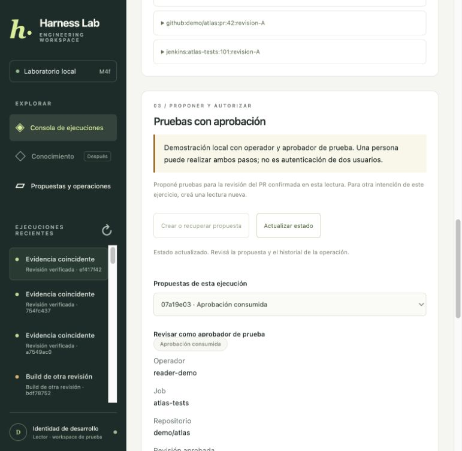

# M4f worker independiente de escrituras

[Índice](../guide.md) · [← Anterior](35-m4e-resolucion-manual-de-unknown-con-evidencia-del-proveedor.md) · [Siguiente →](37-m4g-observabilidad-del-worker-y-del-ledger-de-escrituras.md)


### Paso 1 separar admisión y ejecución

En el modo nuevo, «Encolar solicitud simulada» no llama al proveedor. La API confirma un trabajo durable en PostgreSQL y devuelve HTTP 202. Un proceso independiente lo reclama y usa el mismo `Operations` para ejecutar o recuperar.

```text
Navegador → API → write_jobs (PostgreSQL)
                         ↓ reclamo con lease
                    WriteWorker
                         ↓ Operations + guard de reclamo
                    MCP → simulador persistente
                         ↓
                    ledger + eventos (PostgreSQL)
```

La cola no reemplaza al ledger: el ledger decide si hubo aceptación o incertidumbre. Un trabajo RUNNING significa que un worker lo atiende; no prueba que Jenkins aceptó nada. SUCCEEDED del ledger sigue significando aceptación de la solicitud, no éxito de CI.

Agregamos `harness/write_queue.py`, `harness/write_worker.py` y `004_write_jobs.sql`. `proposal_schema_version` pasa a 4; no cambia la versión de las tablas de runs ni el worker de lecturas.

### Paso 2 activar los procesos locales

Con Compose y su worker de lecturas activos, ejecutá la API M4 en una terminal:

```bash
uv run python -m harness.web --storage postgres --approvals-demo --write-worker --port 8003
```

En otra terminal, iniciá el worker de escrituras:

```bash
uv run python -m harness.write_worker
```

Abrí http://127.0.0.1:8003 y recargá la página para leer el modo nuevo. Ambos procesos usan el mismo PostgreSQL, directorio de identidades de prueba y archivo persistente del proveedor. El contenedor 8002 y el consumidor de lecturas continúan como estaban.

`--write-worker` requiere el modo M4 local, PostgreSQL y bind loopback. Sin esa opción se conserva el modo síncrono de M4d/M4e para comparar. En el modo nuevo, la API no arranca un worker escondido ni envía pruebas si el proceso no está disponible.

Para procesar un trabajo elegible y terminar, usá `--once`. Si no hay un trabajo elegible —por ejemplo, todavía no venció una espera— termina sin hacer I/O al proveedor; el modo continuo vuelve a revisar cada medio segundo.

### Paso 3 admitir una intención una sola vez

Después de aprobar y preparar la operación, el botón de envío llama la misma ruta HTTP, pero encola. `write_jobs.operation_id` es UNIQUE: repetir la solicitud devuelve el mismo trabajo, incluso con la cola llena. Cambiar el punto de fallo de un trabajo ya admitido da conflicto; no cambia su intención durante recuperación.

Cada trabajo tiene ID, operación, estado, intentos de reclamo, propietario, token de fencing, lease, próximo instante elegible y resultado/error sanitizados. El navegador no puede aportar propietario, token, duración del lease ni ID de worker. Esos campos se asignan internamente; propietario/token no se devuelven en la vista pública del trabajo.

La admisión está limitada a dieciséis trabajos PENDING/RUNNING por actor/workspace y se serializa en PostgreSQL para evitar carreras de cuota. El reclamo tiene un máximo de cinco intentos acumulados: repetir la admisión no reinicia el contador. Alcanzar ese máximo deja el trabajo en revisión, sin declarar un efecto que no comprobamos.

No se encolan de nuevo operaciones históricas por abrir la pantalla o reiniciar la API. Una operación ya terminada permanece como historia. La propuesta original sigue consumida y solo tiene su operación única.

### Paso 4 reclamar trabajo con lease y fencing

El worker selecciona trabajo con `FOR UPDATE SKIP LOCKED`, acotado a su actor/workspace de confianza. Dos workers pueden competir sin reclamar simultáneamente la misma fila. Al reclamar se incrementan intentos y token de fencing, y se asigna un propietario aleatorio del proceso.

El lease del trabajo dura quince segundos por defecto. El heartbeat intenta renovarlo cada tercio de ese plazo. No renovamos un reclamo que ya venció ni uno con otro propietario/token.

Si un proceso quedó obsoleto, las comprobaciones en SQL le impiden usar el ledger o confirmar resultados. El guard verifica trabajo RUNNING, operación, propietario, token y lease vigente; comparte la transacción del ledger. Se verifica también antes de transiciones y antes del I/O.

`Operations` acepta un guard opcional para este ejecutor. Sin guard conserva el comportamiento anterior de CLI/demo; con guard protege las acciones del worker. No construimos un segundo algoritmo de despacho ni reiniciamos los presupuestos del run de lectura.

### Paso 5 distinguir los dos leases

| Control | Función |
| --- | --- |
| Lease renovable del trabajo, 15 s | Determina qué worker puede atender y confirmar ese trabajo. |
| Lease del ledger DISPATCHING, 10 s | Delimita el intento de envío y cuándo puede investigarse un resultado abandonado. |
| Timeout MCP, 4 s | Acota conexión/descubrimiento/llamada del cliente. No demuestra ausencia de efecto al cancelar. |
| Vencimiento de aprobación, 30 min | Impide iniciar una acción con autorización vencida. |

El `not_after` enviado al proveedor es el menor entre vencimiento de aprobación, lease del ledger y lease del trabajo observado al reclamar el despacho. Así un proceso suspendido no puede despertar y producir un efecto nuevo después de ese límite, aunque antes haya pasado una validación local. Una renovación posterior del heartbeat no amplía aquel límite de aceptación ya fijado.

Un rechazo explícito por vencimiento conserva NOT_APPLIED; un timeout o respuesta no fiable conserva UNKNOWN. Cancelar una tarea Python o perder un heartbeat no revierte ni demuestra que se detuvo un efecto remoto: mantenemos esa distinción.

### Paso 6 recuperar según el ledger, no repetir el programa entero

El worker decide su recorrido a partir del estado durable:

| Estado del ledger | Trabajo permitido |
| --- | --- |
| PREPARED | Primer envío, con todas las revalidaciones y el guard actuales. |
| DISPATCHING | Esperar su lease si sigue activo; después consultar, sin enviar. |
| UNKNOWN | Consultar el efecto por el mismo ID/hash, sin enviar. |
| SUCCEEDED / NOT_APPLIED | Finalizar/sincronizar el trabajo sin I/O de escritura. |

Si el proceso muere después de reclamar el trabajo pero antes de confirmar DISPATCHING, el siguiente propietario encuentra PREPARED y puede realizar el primer envío. El anterior ya no tiene un guard válido.

Si muere después de aceptar la solicitud, el siguiente propietario encuentra DISPATCHING/UNKNOWN. No llama `request`; usa `lookup`. Puede diferir el mismo trabajo hasta que venza el lease del ledger, usando el reloj de PostgreSQL. Un nuevo reclamo no significa una nueva llamada de escritura.

No se mantienen transacciones PostgreSQL abiertas durante la solicitud al proveedor. La confirmación posterior exige el reclamo actual y la versión esperada del ledger; un worker viejo no sobrescribe una resolución más reciente.

### Paso 7 aparcar incertidumbre y conservar la revisión manual

Si la búsqueda encuentra el recibo, termina SUCCEEDED/DONE. Si no tiene evidencia suficiente, el ledger queda UNKNOWN y el trabajo pasa a NEEDS_REVIEW. No hacemos polling infinito ni un reenvío automático sobre ese ID.

Mientras exista DISPATCHING/UNKNOWN para el recurso, no se reclaman nuevos trabajos PREPARED que intenten escribir en él. Sí puede investigarse una operación incierta: una consulta no es otro efecto.

La revisión manual de M4e sigue disponible. Al confirmar el cierre o resolver por consulta, el worker sincroniza el trabajo a DONE en un ciclo posterior. Si había un reclamo todavía activo, espera que termine o venza; no le arrebata el trabajo por cambiar solo la pantalla.

Una cuota agotada, un error local o un trabajo en revisión no reinicia la aprobación ni autoriza otro UUID. Los casos agotados requieren investigación; este incremento no agrega un botón que borre contadores o relance escrituras inciertas.

### Paso 8 recorrerlo desde la pantalla

1. Iniciá la API con `--write-worker`, dejando inicialmente apagado el worker de escrituras.
2. Ejecutá una lectura, creá la propuesta, aprobala y prepará la operación.
3. Elegí «Después de aceptar la solicitud» para el ejercicio de fallo.
4. Pulsá «Encolar solicitud simulada». La operación sigue PREPARED y el trabajo muestra «Esperando worker», con cero reclamos. No hubo efecto.
5. Iniciá `python -m harness.write_worker`.
6. El primer reclamo acepta la solicitud por MCP, deja DISPATCHING y difiere el mismo trabajo por el punto de fallo.
7. Tras el vencimiento del ledger, el siguiente reclamo consulta automáticamente y termina. No hace falta pulsar «Consultar» para que el worker recupere este caso.
8. Revisá «Solicitud aceptada», trabajo «Finalizado» y el historial PREPARED → DISPATCHING → UNKNOWN → SUCCEEDED.

El refresco de la UI solo consulta. Un trabajo ya admitido deshabilita otro envío y congela el punto de fallo. La respuesta 202 indica admisión, no aceptación del proveedor ni resultado de build.

Ejecutamos este recorrido visual: sin worker comprobamos PREPARED/PENDING, cero reclamos y cero solicitudes del proveedor. Después del arranque terminó con dos reclamos y exactamente un efecto simulado para el mismo operation ID. La lectura original conservó cuatro decisiones y tres herramientas.



### Paso 9 parar y volver a iniciar sin perder intención

SIGTERM y Ctrl-C detienen nuevos reclamos y dejan terminar el intento actual. Un heartbeat acompaña ese trabajo hasta finalizarlo. La prueba con un proceso real verifica salida ordenada, ledger aceptado y una sola solicitud.

Ante terminación abrupta, el lease vence. Reiniciar la API no ejecuta la cola; reiniciar el worker sí permite recuperar trabajos elegibles. Los tests también apagan la API después de encolar y ejecutan un worker en otro proceso, demostrando que el envío no depende del servidor HTTP vivo.

Los flags `--crash-at after-claim` y `--crash-at after-send` requieren `--once` y son exclusivos del laboratorio. Terminan ese proceso con código 17 para probar ambas ventanas. Usalos con los schemas/archivos aislados de las pruebas, no para provocar incertidumbre inadvertidamente en una sesión que querés seguir usando.

El worker de escrituras es un proceso local independiente del worker Docker de lectura y del planificador TLS. No se agregó un servicio del sistema, una automatización ni un contenedor nuevo.

### Paso 10 pruebas, compatibilidad y límites

```bash
uv run python -m unittest discover -s integration_tests -p 'test_write_worker*.py' -v
uv run python -m unittest discover -s integration_tests -v
uv run python -m unittest discover -s tests -v
uv run python scripts/evaluate.py
```

Las pruebas nuevas cubren admisión sin envío, duplicados, cuota, contador persistido, dos consumidores, heartbeat, propietario obsoleto, permisos revocados, sincronización tras revisión manual, SIGTERM y muertes reales antes del despacho y después del efecto. Las de HTTP demuestran API apagada durante el envío, reapertura con el mismo ledger, recuperación por consulta y rechazo de metadatos de reclamo aportados por el cliente.

Las suites previas siguen cubriendo lectura, autorización, plazos, aprobación, evidencia, consumo único, simulador, cierre y MCP. El core y el worker de lecturas no cambian; `Operations` solo añade el guard y el límite de aceptación del trabajo. La CLI síncrona continúa disponible como comparación explícita de etapas; ambos caminos usan el mismo ledger, no una segunda operación.

Siguen pendientes identidad de usuarios real, despliegue containerizado y almacenamiento del proveedor, más métricas/trazas/evals de escrituras. Estos mecanismos controlan el proveedor ficticio del laboratorio; no prometen ejecución exactamente una vez en Jenkins real sin comprobar sus contratos.

Validación M4f: **198 pruebas locales, 100 PostgreSQL y 9/9 evaluaciones de lectura aprobadas**. Incluyen catorce pruebas nuevas de worker/HTTP. El caso SIGTERM se verificó además reteniendo el lock de recurso hasta que el hijo estuviera RUNNING, para probar una parada en curso sin depender de una carrera de timing. En navegador se observó admisión sin worker y posterior recuperación automática after-send: trabajo DONE con dos reclamos, ledger SUCCEEDED y una solicitud del proveedor. El run original conservó cuatro decisiones/tres herramientas. No quedaron trabajos pendientes/activos ni operaciones inciertas de prueba. Gitleaks no encontró secretos; los reportes siguen ignorados por Git.
